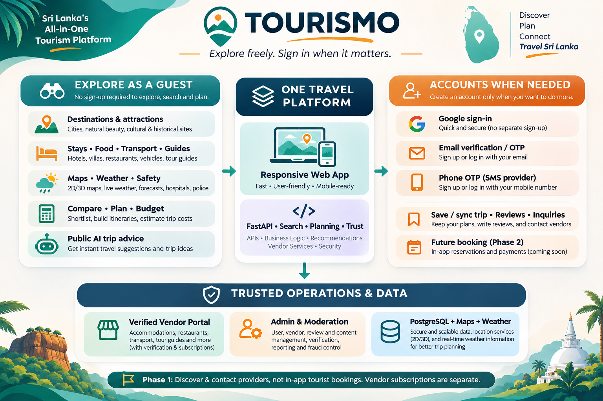
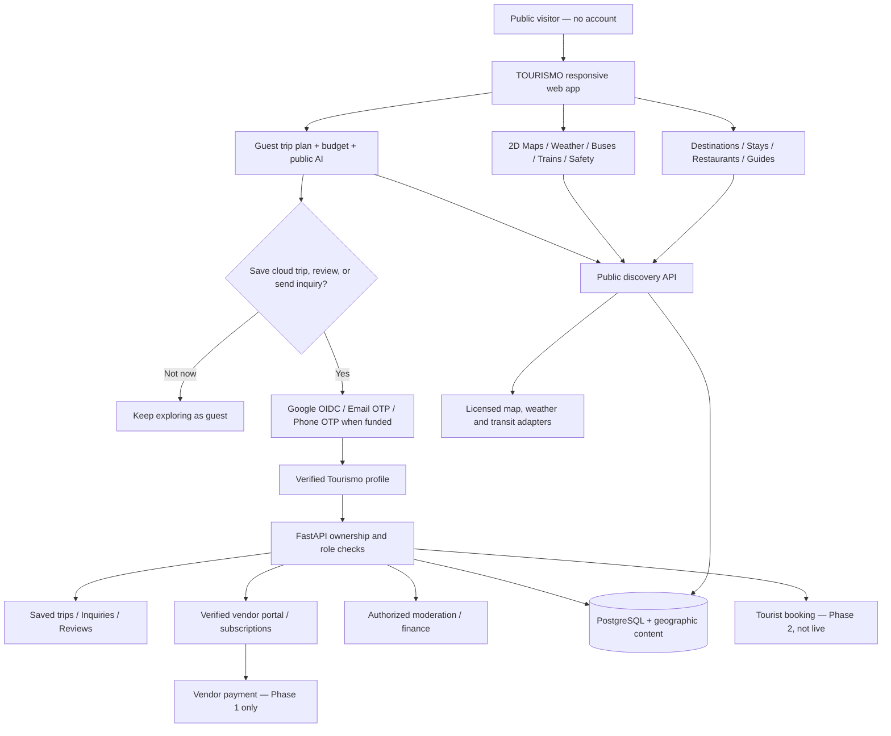
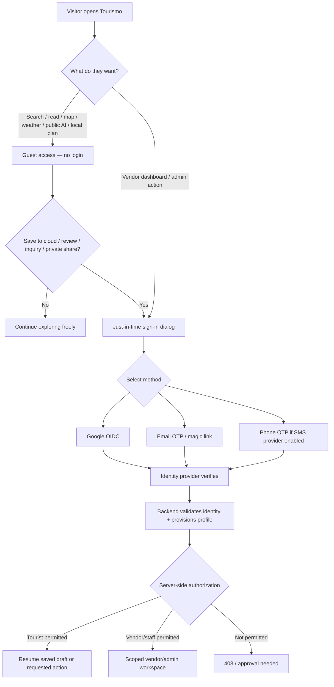
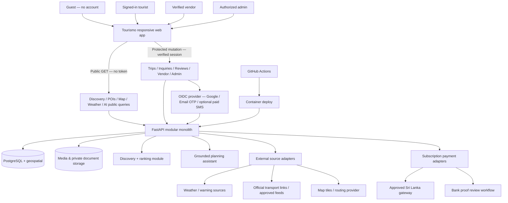
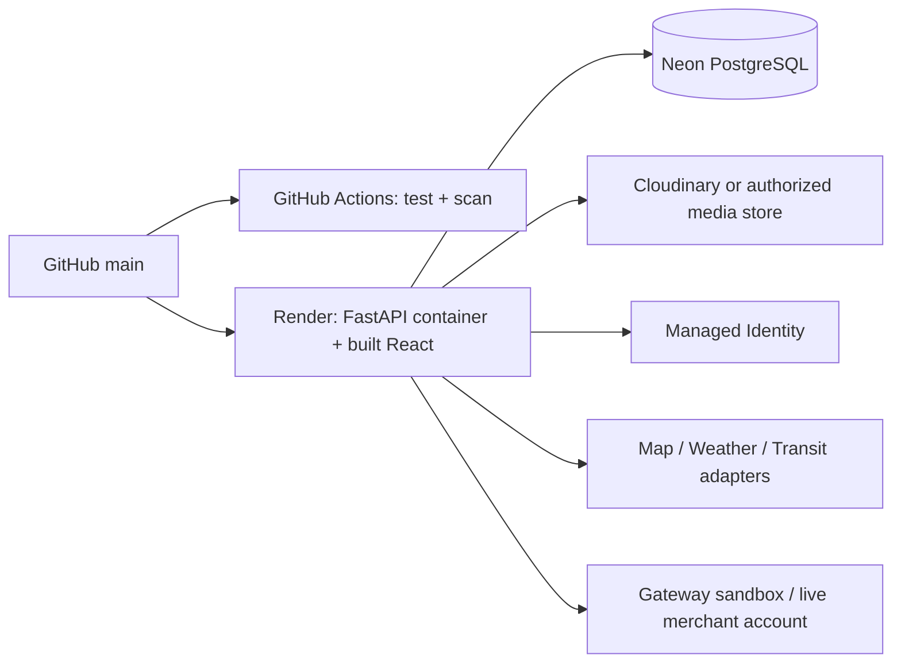
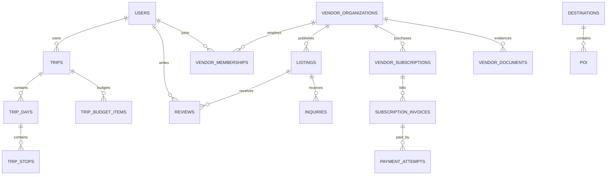

# TOURISMO — SRI LANKA'S CONNECTED TRAVEL ECOSYSTEM

> **MASTER PRODUCT REQUIREMENTS, SOLUTION ARCHITECTURE & DEVELOPMENT BLUEPRINT**  
> Product name: **Tourismo** (selected by the product owner; still perform trademark, domain and company-name clearance before public launch).  
> Version: **1.1 — Guest-first identity & onboarding revision**  
> Prepared: **19 November 2026**  
> Geography: **Sri Lanka** | Currency: **LKR** (display converted estimates when useful) | Timezone: **Asia/Colombo**  
> Clients: **Responsive web app first; Android/iOS later**  
> Status: **Proposed solution, not an already-built or integrated system**  
> Delivery objective: **Build the trusted, accessible, genuinely useful single starting point for planning a journey anywhere in Sri Lanka.**

---

## THE PRODUCT IN ONE LINE

> **Explore Sri Lanka without signing up. Create a Tourismo account only when you want to save, contribute, inquire, manage a business or (in Phase 2) book.**

**Primary UX rule:** public travel discovery is freely accessible; authentication is a just-in-time, secure step for account-bound actions. A guest is not an error case or a second-class user.

## QUICK NAVIGATION

- [Guest-first experience, Google/email/phone sign-in, action gates](#12-public-user-access-and-onboarding)
- [Product vision and market problem](#part-a--product-vision--market-logic)
- [Real user journeys: Anuradhapura, Nuwara Eliya, vendors, AI](#part-b--exact-user-experiences)
- [Complete functional feature catalogue](#part-c--feature-catalog-and-product-rules)
- [Vendor trial, payment gateway, bank-slip verification](#part-d--vendor-business-model-subscriptions-and-payments)
- [Administration, reviews, scams and trust](#part-e--administration-trust-operations-and-content-governance)
- [AI trip assistant and search ranking](#part-f--assistant-recommendation-and-data-products)
- [Architecture, APIs, database, security and UX](#part-g--system-architecture-and-engineering)
- [Roadmap, costs, risks and launch decisions](#part-h--delivery-program-costs-risks-and-release-gates)
- [Sri Lanka official sources and research findings](#part-i--public-source-register--research-notes)
- [Ready-to-copy prompt for the next ChatGPT conversation](#part-j--ready-to-copy-new-chat-implementation-brief)

---

## HOW TO USE THIS DOCUMENT

This is a **single source of truth** to paste into another ChatGPT conversation or provide to a development team. It defines product intent, business rules, page-by-page requirements, integrations, architecture, database, APIs, security, testing, rollout and priorities. A proposed feature is **not** a claim that a live partner integration or live data feed exists.

**Requirement notation:**
- **P0 — Foundation/MVP:** Must function for the first credible public launch.
- **P1 — Launch expansion:** Important next increment after P0 is stable.
- **P2 — Advanced:** Later web release, partnership dependent or costly.
- **PH2 — Booking phase:** Booking, reservations, customer payments and related fulfilment (explicitly excluded from first customer-facing release).
- **MOB — Mobile:** Android/iOS app roadmap.
- **EXTERNAL:** Depends on permission, provider, license, commercial agreement or data availability.

**System boundaries:** During Phase 1, tourists can **discover, compare, plan and estimate budgets as guests without any account**; they can share a non-sensitive local export without login. They **sign in only to save/synchronize private trips, collaborate with permissions, send stored inquiries, write reviews, submit account-bound reports and manage notifications**. They can click a public vendor's verified contact methods without an account; any accommodation or service booking is arranged directly with the vendor **outside Tourismo**. Vendors may pay **Tourismo for vendor-subscription services** via approved payment gateway or bank-transfer-slip review. These are two different money flows and must never be confused.

**Evidence/uncertainty:** Public-source findings appear in the research notes and source register; competitor gaps, prices, transport data freshness, precise license coverage, payment eligibility and provider contracts require discovery and validation before promises are made to customers.

---

## TOURISMO — GUEST-FIRST PRODUCT ARCHITECTURE

> **Explore freely. Sign in when it matters.**



*Illustrative product map. "Live" data, 3D map tiles, SMS login and vendor integrations only become active when verified sources, licenses, capacity and payment services are configured; the image does not assert integrations are already operating.*



**Design principle:** the public discovery plane and the authenticated contribution/operations plane share one application without sharing permissions. No private tourist or vendor data is available to anonymous API requests.

---

# PART A — PRODUCT VISION & MARKET LOGIC

## 1. Executive vision

A family planning a trip to Anuradhapura, Nuwara Eliya or anywhere else in Sri Lanka should not have to visit a dozen unrelated websites, social pages and messaging groups to discover accommodation, transport, places to visit, food, guides, weather, safety information and a realistic budget. **Tourismo** connects this fragmented journey in one guided experience, with a curated and verified local-vendor marketplace.

The proposed value is not merely another hotel directory. It is an **evidence-backed trip-planning and vendor-discovery platform** combining:
1. **Understand the place** — what it is known for, culture, transport, weather, opening guidance, family suitability and nearby essentials.
2. **Find the right providers** — capacity-aware accommodation, food, transport, qualified guides and specialist activities, filtered by verified attributes and pricing.
3. **Plan realistically** — map-based itinerary, travel durations, daily pacing, budget ranges, public-transport possibilities and contingencies.
4. **Make informed contact** — official contact and inquiry channels; no customer booking or vendor-service payment processed inside the app in Phase 1.
5. **Stay safer** — provider verification, explainable trust indicators, scam reports, transparent review moderation, source timestamps and official emergency links.
6. **Support local businesses** — managed business profile, menus/room types/rates, analytics, trial and subscription, lead visibility, verification workflow.
7. **Ask a planning assistant** — grounded conversational guidance that searches internal listings and approved information and clearly distinguishes verified facts from estimates.

### Product promise
> **"Tell us where, when, with whom and your budget. We'll help you discover Sri Lanka, choose trusted local services, and build a trip you understand."**

### Non-promise
We do **not** guarantee safety, availability, prices, weather, public transport arrival times or vendor fulfilment unless a specific data source/contract warrants such a guarantee. No listing badge alone guarantees that a person or business is safe or legally compliant. The first release is **discovery and planning**, not a travel agency booking engine.

## 2. The problem, decomposed

| Pain point | Human impact | Product response | Reliability safeguard |
|---|---|---|---|
| Search scattered across Facebook, maps, blogs and calls | Time, inconsistent information | Unified destination and provider catalogue | Source/date/owner visible |
| Unclear accommodation suitability for families | Rooms too small, child age rules unclear | Adults/children + ages + beds + unit capacity filters | Vendor-maintained occupancy rules, confirmation label |
| Misleading prices and hidden charges | Budget surprises | Itemized estimate, taxes/fees and quote date | "From" vs fixed rate clearly marked |
| Fake providers, scams or false reviews | Safety and financial harm | Document checks, reported-content queue, trust indicators | No fabricated endorsements or blanket 'scam-free' claims |
| Public-transport planning is confusing | Missed connections, impractical itineraries | Train/bus discovery and station/stop linkage | Official sources, last-updated date, no invented live status |
| Not knowing what to do in a location | Poor route and experience selection | Thematic destination guides and nearby POIs | Local editorial checks and provenance |
| Budget difficult across six travelers | Overspending and disputes | Group-aware estimates, category envelopes, shared expenses | Forecast ranges, clear assumptions |
| Vendors lack discoverability and control | Dependence on ads/social presence | Customizable profiles, leads and analytics | Transparent ranking and subscription terms |
| Visitors need help mid-trip | Weather, closures, hospitals, police | Safety and essential-services panel | Government links + manual fallback |
| Information not available in user's language | Exclusion | Sinhala, Tamil, English multilingual content | Human-reviewed critical translations |

## 3. Competitive reality and differentiation

There **are** existing travel and mobility products used in Sri Lanka (e.g., Booking.com, Agoda, Tripadvisor, Google Maps, PickMe, Uber and train/community services). Do not market the product as though no existing solutions exist. The opportunity to validate is **a Sri Lanka-specific, cross-category, group-budget-aware, trust-oriented aggregation and planning experience**, not unique ownership of any single feature.

Research hypotheses to test with real users:
- Local groups struggle more with **capacity, transport, affordability and local-language discovery** than with basic hotel search.
- Overseas travelers value **verified local providers, safety/cultural guidance and realistic travel time**.
- Smaller licensed providers will pay for measurable, qualified leads, not merely a vanity listing.
- Users will trust the platform more if reviews are fair, commercial promotions are disclosed and safety alerts name their sources.
- Regional content quality may differentiate more than generative AI alone.

**Discovery research before building:** interview 20–30 tourists (local families, backpackers, overseas visitors, accessibility-needing users) and 15–20 providers across regions, run competitor task-comparisons, test willingness-to-pay, and measure how often searches are impossible to fulfil with real inventory. Treat all numbers here as **research targets**, not market findings.

## 4. Target audiences and roles

### Tourist-side personas
- **Local family planner:** 2 adults + 3 children, budget cap, vehicle options, nearby rest stops, family rooms; starts without registration.
- **Friends/group organizer:** 6–12 adults, flexible budget, several rooms, shared itinerary and cost split.
- **International first-time visitor:** airport arrival, currency/language, verified guides, ETA links, safety information.
- **Budget solo traveler:** buses/trains, homestays/hostels, low-cost meals, walkable attractions.
- **Senior / accessible traveler:** step-free accommodation, gentle pacing, medical facilities and verified accessibility features.
- **Nature/adventure visitor:** activity operators, permits, park rules, guides, weather and risk warnings.
- **Pilgrimage/cultural visitor:** temple/church/mosque/kovil etiquette, hours, attire, festival/holiday crowds.

### Vendor-side personas
- Hotel, guesthouse, villa, bungalow, homestay, hostel, eco lodge, rented apartment.
- Restaurant, cafe, tourist-friendly eating place, food stall, culinary-experience host.
- Transport company, car/van driver, tourist vehicle, tuk-tuk, bicycle rental, minibus operator.
- Registered guide, activity operator, safari operator, water-sports provider, hiking instructor.
- Event/experience host, local crafts or relevant tourism business (eligibility rules vary).

### System roles — RBAC + tenant ownership
| Role | Typical rights |
|---|---|
| Anonymous guest | Search, read, filter, compare, map, see weather/transport, use bounded public AI, preview a browser-local itinerary and budget, and use public vendor contact links; **no account or login prompt** |
| Verified tourist account | All public access, plus cross-device saved trips/favorites, hosted sharing, inquiries, eligible review submissions, reports, notifications, and personal settings |
| Vendor applicant | Submit KYC/business/license evidence; cannot publish before approval |
| Vendor owner | Manage own organization, listing, prices, media, trial/payment requests, inquiries |
| Vendor staff/editor | Limited assigned listing/menu/lead capabilities; no payment/admin-role changes |
| Tourist guide | Specialized provider profile, certifications, languages, routes, contact |
| Content editor | Curate destinations/POIs, not finance or private identity documents |
| Moderator | Review reports, hide content pending appeal, issue reasoned decisions |
| Verification officer | Inspect evidence/licenses and expiry dates; approve/reject with trace |
| Finance officer | Reconcile subscriptions, verify bank deposit proof, handle refunds |
| Customer support | Handle tickets with scoped temporary access, not raw passwords |
| Platform admin | Policy/configuration, moderation oversight, reporting; scoped audited powers |
| Super administrator | Very small set of break-glass operations, hardware-backed MFA, full audit |
| AI/system service | Strict read-only scoped retrieval; never independently executes finance/admin actions |

**No role gets unrestricted access to sensitive information simply because the UI labels it "admin."** All permissions are enforced server-side; sensitive actions require reauthentication, explicit reason and tamper-evident audit events.

## 5. Success metrics and quality metrics

**Demand:** search-to-provider-profile rate; itinerary creation and completion; relevant-provider coverage by destination; qualified inquiry rate; returning users; trip-share rate; user trust score; complaint resolution time.

**Supply:** verified active listings by category/district; search-result freshness; vendor trial-to-paid conversion; response rate and median response time; listing completeness; stale inventory percentage; renewal rate.

**Quality/safety:** genuine-review acceptance, report false-positive rates, verified license expiration coverage, fraudulent vendor detection response time, pricing discrepancy complaints, unavailable travel-data percentage, AI citation correctness.

**Performance:** API P95 latency; mobile page LCP/INP/CLS; DB capacity; failed vendor payments; unauthorized request rate; backup restore outcome; support incidents.

Set numeric SLOs only after baseline testing; illustrative proposed targets appear in Part H.

---

# PART B — EXACT USER EXPERIENCES

## 6. End-to-end case A: Family trip to Anuradhapura

**Scenario:** A tourist plans a **3-day trip to Anuradhapura for 5 people: 2 adults + 3 children**. The children are assumed to have ages of **4, 9 and 13 solely for this test scenario**. The budget is **LKR 90,000**, negotiable to LKR 110,000; starting city Colombo; traveling by train or hired van. These amounts are **test inputs**, not actual quoted prices.

### Journey
1. Open app without sign-up. Prominent search field: `Where would you like to go?` with multilingual names and autocomplete.
2. Select Anuradhapura and dates. Enter 2 adults, 3 children **with ages**, rooms needed, pets/accessibility preferences, budget maximum and flexibility.
3. App creates a **Destination Overview**: historic/cultural attractions, etiquette, walking/heat considerations, family-friendly suggestions, transport approaches, POIs and safety contacts, weather date/source.
4. **Stay finder** queries *approved* accommodations with relevant max occupancy, child/extra-bed rules, suitable room combination or entire-property rental, selected dates if vendor has submitted them, budget and verified amenities.
5. Result cards display specific **capacity assumptions**, cost model, minimum stay, up-to-date timestamp, verified fields, review summary and directly contactable vendor information. **"Ask vendor to confirm availability and total price"**, never misleading "Book now".
6. If no eligible options, **progressively widen geographic search** (e.g., 5 → 10 → 20 → 40 km, configurable) or use road travel-time rather than radius; show distance and travel penalty, request permission to expand, keep capacity/children/budget constraints, and explain any loosened constraint.
7. Simultaneously show **train/bus/private vehicle options**, cost ranges, transfers, stations, known schedules and authoritative booking/information links. For five travelers, the official railway reservation maximum per transaction may align; for six travelers a single booking attempt would not suffice. The platform **does not reserve seats**.
8. Show attraction choices, surrounding parks, restaurants and food preferences, clinics/hospitals, police stations, pharmacies, fuel, ATMs, public toilets and accessible places of worship where mapped/verified.
9. Tour planner suggests an **editable** morning/afternoon/evening itinerary with visit times, opening-hour checks, estimated journey times, rest breaks, nearby meals and child-friendly pacing; no impossible simultaneous stops.
10. Budget planner calculates **per category, per day, per adult/child, and per person**, tracks confirmed versus indicative quotations, adds contingency buffer and visualizes the upper/lower total.
11. Guest may build and preview the complete itinerary and budget **without authentication**; an ephemeral browser-local draft and a non-sensitive print/export do not require an account. When selecting **Save across devices**, **Invite collaborators** or **Create a revocable hosted share link**, show a just-in-time sign-in dialog, then (with explicit user confirmation) import the guest draft into the authenticated account. Never automatically publish a guest's private itinerary.
12. User contacts accommodation and transport providers via click-to-call, WhatsApp or internal **inquiry only** form. Each provider confirmation remains outside the system.
13. If an actual interaction occurs, the user can read reviews as a guest but must authenticate and meet review eligibility rules to **publish a review** with encounter evidence through privacy-safe checks. Vendor may respond; admin moderates fairly.
14. During trip, user views pinned stops, nearby verified essentials and updated warnings from sourced information; if data is stale, display a warning.

### Edge cases
No listings; children exceed room cap; infants free but count in fire-code capacity; all nearby vendors unverified; provider price in USD but payment in LKR; dates conflict with closures; no railway data; holiday/Poya travel effects; storm/flood warnings; destination name ambiguous; user revises party size; provider withdraws listing; nearby districts but unreachable roads; offline network; accessibility requires *verified* property information.

### Acceptance examples
- **Given** only a four-person villa and a five-person guesthouse, **when** searching for 2+3 travelers, **then** the villa must not falsely appear as a valid sole accommodation.
- **Given** no eligible listing within 5 km, **when** expanding to 20 km, **then** results display extra journey distance/time and do not silently remove the family-capacity filter.
- **Given** a budget cap, **when** high quote estimates exceed it, **then** UI shows "over budget" and suggestions with explicit trade-offs rather than claiming the trip fits.
- **Given** a provider has not entered real-time room availability, **then** UI cannot show "available now".

## 7. End-to-end case B: Friends' Nuwara Eliya tour

6 people, 2 nights, seasonal weather concern, public transportation option and flexible spending.

- Search Nuwara Eliya, enter six adults; app highlights town, tea country, gardens, scenic routes, local produce and nearby experiences.
- For train travel, the route planner **links Nanu Oya station** to the destination with a local transfer leg; does not claim a railway station is in Nuwara Eliya town.
- Official rail-seat reservation instructions currently specify **up to five passengers per online reservation**; show that limitation and direct users to the official portal rather than implementing unofficial third-party booking. [Rail official](https://seatreservation.railway.gov.lk/mtktwebslr/)
- Compare bus + onward local transport, hired van and mixed-mode itinerary with estimated, non-guaranteed costs.
- Weather widget distinguishes **near-term forecast** from *historical climate averages*; fog/rain precautions do not become precise predictions months ahead.
- Accommodations grouped as family rooms, suites, 3 double rooms, villa or bungalow; show occupancy/room-type combinations.
- Search restaurants for halal/vegetarian/allergen needs, opening times, menus and seasonal availability.
- Edit route and budget; optimize for scenery / least travel / accessibility rather than always choosing minimum time.
- Explain highland-road travel buffers, changing conditions and driving safety advice, with source.

## 8. End-to-end case C: Overseas traveler with a local guide

- Select origin airport/city, nationality optional (only when useful), language and accessibility needs.
- Read accurate official links to **ETA and immigration information**; never claim the app issues a visa.
- Filter licensed/local guides by region, language, specialty, verified credentials, rate basis and availability **as stated by vendor**.
- Request a quote and compare options; browse cultural etiquette, appropriate attire, photography rules, regional holidays and official attractions/entry-ticket channels.
- Give an emergency information sheet including 1912 tourism assistance, 119 police, 1990 ambulance, local hospital and 117 disaster center where appropriate; show dates, sources and telecom limitations.

## 9. End-to-end case D: Vendor onboarding + 30-day trial

- Provider signs up with verified email and optional phone OTP (SMS cost acknowledged), MFA strongly recommended/required for finance/owner roles.
- Choose organization type and category; input legal business name, registration no., operating address, geo-point, contact details, owner/authorized representative, relevant SLTDA registration or category-specific license and expiry, supporting documents.
- Submit for review; moderation/verification officer checks documents and cross-references official sources where legally/technically possible.
- Only after approval can public listing appear. **Verification and subscription entitlement are independent**.
- Start one **30-day organization-level trial** on the policy-defined trigger (recommended: first listing approval, not sign-up, to avoid consuming time in verification queue).
- Vendor edits room types/menu/services, photos, rate cards, staff, languages, operating areas, availability notes and contact channels.
- Dashboard shows views, contact clicks, qualified inquiries, listing health, expiry, payment history, subscription state and reports.
- Trial notifications at 7/3/1 day remaining. After expiry, use explicit policy: basic listing stays discoverable but paid lead features are limited, or listing becomes archived; choose only after user research and disclosure. Never silently delete vendor content.
- Vendor can **pay the platform** via gateway or upload bank deposit proof; payment goes through verification and audit process before entitlement is activated.
- Fraudulent document, repeated duplicates, abuse or legal non-compliance trigger hold/suspension with review/appeal process.

## 10. End-to-end case E: AI trip assistant

**User:** "I want to visit Kandy for three days with my parents and two kids, stay near a railway station, eat vegetarian food, and keep the trip under Rs. 75,000. What can we do?"

**Assistant flow:** detect Kandy, 3 days, group composition, transit access, diet, hard budget; ask only for missing essential parameters; retrieve approved listings, transport references, destination POIs, recent weather, and price ranges; build shortlist and itinerary; show assumptions, sources, freshness, confidence and alternatives; allow **Add to my trip**, **Adjust budget**, **Show on map**, **Contact provider**.

**Not permitted:** invent a live train departure, guarantee a room, fabricate a license or rating, reveal another user's private budget, make bookings, or autonomously activate a vendor subscription. If evidence is insufficient, say so and offer verified links.

---

# PART C — FEATURE CATALOG AND PRODUCT RULES

## 11. Product modules — priority matrix

| Module | P0 core capabilities | P1/P2 extensions |
|---|---|---|
| Public home | Destination search, hero, discovery categories, safety/trust explanation | Personalized seasonal feed, smart recommendations |
| Identity & guest access | **Zero-friction public discovery, just-in-time Google/email verification, secure profile provisioning and route guards** | Paid/approved phone OTP, passkeys/step-up, trusted account linking |
| Destination knowledge | Curated district/city pages, specialties, essentials, tags, sources | Festivals, hyperlocal walks, expert collections |
| Search & filter | Text, date, budget, group capacity, radius, category, verified flags | Semantic search, comparative AI, travel-time polygons |
| Accommodation | Full listing, units/room types, capacity, child ages, amenities, prices, contact | Vendor-entered availability calendar, packaging |
| Restaurants | Menu, dietary/allergen tags, prices, seating, opening hours, contact | Menus in 3 languages, specials, accessibility |
| Transport | Private provider cards, routes, vehicle capacity, rate types, train/bus links | Partner timetables, multimodal optimization, alerts |
| Guides & activities | Credentials, languages, areas, tours, safety, pricing, inquiry | Verified skill badges, multi-day guide plans |
| Maps | Interactive 2D pins, filters, itinerary line, emergency POIs | 3D terrain, offline licensed map assets, accessibility map |
| Trip planning | Days, stops, travel windows, accommodation shortlist, budget | Collaborative editing, optimization, version history |
| Budget | Category estimates, actual manually entered expense, buffer | Shared cost splits, multi-currency and forecasts |
| Weather & alerts | Forecast source, observation time, official disaster links | User opt-in weather-risk notifications |
| Trust & reviews | Ratings, verified-interaction indicators, reports, responses, appeals | Reputation engine, anomaly detection |
| Vendor portal | Profiles, multi-listing, category forms, staff, leads | Content A/B, business benchmarks |
| Verification | Documents, license checks, approval/expiry, audit | External registry integration by contract |
| Subscription | 30-day trial, plans, invoices, slip flow, payment-gateway checkout | Recurring, proration, dunning, tax integrations |
| Admin console | Users, vendors, content, reports, disputes, finance, audits | Regional teams, policy automation, fraud analytics |
| AI assistant | Deterministic filters + grounded retrieval + plan suggestions | Controlled LLM, ML ranking, privacy-safe preferences |
| Notifications | Email/in-app, verified inquiry and trial changes | Push, multilingual SMS (paid), preference center |
| Support | FAQs, ticketing, complaints, emergency links | Live human chat, service-level analytics |
| Accessibility/language | Keyboard-friendly, responsive, EN/SI/TA structure | Screen-reader audits, translated editorial catalog |
| Growth | SEO pages, search analytics, consent-based campaigns | Affiliate/partner programs, referral rewards |
| Mobile readiness | OpenAPI and reusable design system | React Native / Expo native apps |

## 12. Public user access and onboarding

> **P0 product rule — guest-first by default:** opening Tourismo, searching a destination or using public planning tools must never force sign-up, Google consent, a mobile OTP, or location permissions. Present a discreet **Log in / Sign up** option and request authentication only as the next step for an explicitly protected action. This rule applies equally to mobile, tablet and desktop.

### 12.1 Three access states

1. **Anonymous guest (P0):** no identity-provider account, no Tourismo `users` row and no authenticated session are required. Guest can search, view, compare, use maps and source-backed weather, browse vendors and reviews, explore public transport, get limited public AI planning and build an editable temporary trip/budget in the current browser. Guest may view a deliberately shared public link to a trip with an expiring, scoped token when the owner enabled it.
2. **Authenticated tourist (P0):** user completes Google sign-in or verified email sign-in; Tourismo creates/links a profile using a validated identity-provider subject. Account can save/sync trips, maintain favorites, request vendor quotes, contribute eligible reviews/reports, collaborate with authorization, enable notifications and manage privacy settings.
3. **Verified business or staff account (P0):** vendor applicants, owners, staff and administrators authenticate before using any restricted dashboard; role/organization membership, document review, permission checks and stronger step-up controls apply. A tourist does **not** become a vendor or admin merely by changing a client-side role value.

**Phase distinction:** booking and tourist checkout are **PH2**, not Phase 1. When introduced, a booking/checkout or modification requires account verification, explicit consent and appropriate payment authorization, but public availability/search can remain guest-accessible.

### 12.2 Permission matrix: exactly when sign-in is required

| Visitor action | Anonymous guest | Signed-in tourist | Vendor / privileged actor | Scope / UX rule |
|---|---|---|---|---|
| Home page, destinations, attractions, culture, prices, weather, emergency information | **Yes** | Yes | Yes | Public metadata, cited sources, freshness | 
| Public accommodation, restaurants, private/public transport, guides, business profiles | **Yes** | Yes | Yes | No hidden sign-in wall | 
| Filters: adults, children/ages, dates, budget, region expansion, compare results | **Yes** | Yes | Yes | No account just for a search | 
| View 2D map / licensed 3D map / route previews | **Yes** | Yes | Yes | Permission only if user elects precise location | 
| Read reviews and vendor answers | **Yes** | Yes | Yes | Moderated public data | 
| AI assistant for **public trip questions** | **Yes, bounded** | Yes, higher/personalized quota | Admin tools separate | Quotas, provenance; do not expose private data | 
| Create/edit itinerary and budget in current browser | **Yes, temporary** | Yes | Yes | Local draft is not a cloud account | 
| Print or locally export a non-sensitive guest itinerary | **Yes** | Yes | Yes | No hosted private sharing implied | 
| Call vendor / open public vendor website / WhatsApp contact | **Yes** | Yes | Yes | Show external-app handoff and scam-prevention tips | 
| Save favorites and trips **across devices** | **Login required** | Yes | By own user account | Preserve draft during login | 
| Host private trip, invite collaborator, protected cloud sharing | **Login required** | Yes | Assigned permissions | Expiring/revocable links, scoped authorizations | 
| Send **stored platform inquiry**, quote request, or provider message | **Login required** | Yes | Vendor recipient | Spam protections; not a booking | 
| Post review, photos, ratings, official correction or account-bound complaint | **Login required** | Yes, eligibility checks | Moderation separate | Reading reviews always public; legitimate negative reviews protected | 
| Follow provider, opt in to notifications or manage saved preferences | **Login required** | Yes | Own tenant scope | Clear consent | 
| Create/verify business, upload licenses, edit listing/menu/rates | **No** | Apply as vendor | Verified vendor | License/doc reviews before publication | 
| View business leads, trial, invoices; pay vendor subscription | **No** | Vendor approval required | Scoped vendor | Strong auth and finance controls | 
| Moderate reviews / verify bank slips / change admin roles | **No** | No | Authorized staff only | Step-up MFA, reason and audit | 
| Reserve accommodation/transport or pay tourist vendor in Tourismo | **Not offered in P0/P1** | **Not offered in P0/P1** | **PH2 only** | Future authenticated booking flow | 

**No deceptive restriction:** Do not render an apparently clickable "Book now" button that sends users to a Tourismo signup page in Phase 1. Use **Contact provider**, **Call**, **Open WhatsApp** or **Request a quote** (last one authenticated); clearly label any external provider booking link.

### 12.3 Authentication methods and identity proofing

| Method | UX | Planned release | Technical/security choice |
|---|---|---|---|
| **Continue with Google** | One-click sign-up **and** sign-in; Google account may be Gmail or Workspace | **P0** | Provider-managed Google OAuth 2.0 / OIDC with Authorization Code + PKCE where applicable; identity provider verifies tokens |
| **Continue with email** | Email address receives short-lived one-time code (OTP) or secure magic link; same flow handles new/existing users | **P0** | Managed provider, attempt limits, expiration, one-use verification and account enumeration protection |
| **Mobile phone / SMS OTP** | Enter number in Sri Lankan **+94** E.164 format or supported foreign country code; verify code | **P1/conditional commercial launch** | Real SMS/WhatsApp OTP provider, carrier coverage, paid delivery and consent; **never simulate a delivered OTP in production** |
| **Google profile email (Gmail)** | User may choose Google OAuth, or type `@gmail.com` into email-code login | **P0** | **Gmail is not an additional authentication protocol**; no collection of Google passwords |
| **Optional passkeys / stronger factors** | Secure device-bound confirmation and recovery | **Security-gated P1** | Evaluate provider availability/pricing; required stronger assurance for privileged/finance actions |

**Pragmatic $0 demo decision:** Prefer a supported managed identity provider (Clerk is an option) for **Google + email OTP**. Phone OTP is architecturally supported but disabled until an approved SMS provider and budget are configured. The free Clerk plan lists Google/social login and email codes, while production SMS codes are a paid capability and international delivery is billed by market; MFA/passkeys availability also depends on the selected plan. Evaluate current alternatives before implementing high-risk vendor/admin roles. See [Clerk pricing](https://clerk.com/pricing), [Clerk auth strategies](https://clerk.com/docs/guides/configure/auth-strategies/sign-up-sign-in-options), and [Supabase phone sign-in](https://supabase.com/docs/guides/auth/phone-login). No promise of unlimited free production SMS.

**Phone-only risks:** SMS interception/SIM swap, recycled numbers, rate abuse and loss of phone access must be included in the threat model. Require secure verified changes, recovery policies and additional assurance for privileged users. Verification of one channel is not sufficient proof of legal identity or a legitimate vendor license.

### 12.4 Just-in-time sign-up / sign-in interaction design

**Primary navbar:** `Explore | Destinations | Stays | Food | Transport | Guides | Plan Trip | AI Assistant` plus subtle `Log in` and `Sign up`; no modal on first page load. Mobile nav offers the same discoverability and an accessible Account item, without requiring authentication.

**Example — Anuradhapura guest flow:**
1. Guest searches `Anuradhapura`, selects **2 adults + 3 children**, dates and LKR budget, and examines public stays, road/rail options and maps.
2. Guest builds itinerary and budget instantly; draft lives temporarily in the browser without creating a back-end tourist identity.
3. Guest clicks **Save my trip**; Tourismo opens a branded, accessible dialog: **"Save this trip and continue on any device"**, showing **Continue with Google**, **Continue with email**, and **Not now**. Phone OTP is visible only when production-ready.
4. No hard redirect that discards results. Store a short-lived pending action/draft handle on the same browser; after the verified sign-in callback, return to the exact trip/search screen with original filters intact.
5. Ask **"Save this draft to your account?"**; only on confirmation persist private itinerary. Do not silently merge with an existing trip or expose it publicly.
6. For **Write a review** or **Request quote**, show the same dialog with purpose-specific wording and replay **only the user's intentional navigation**, never automatically submit a payment, review or irreversible mutation after sign-in.
7. Clicking **Not now** simply closes the dialog and leaves the guest experience usable.

**Accessibility:** focus trap in dialog, `Escape` and visible Close, meaningful error states, correct OIDC error handling, keyboard navigation, mobile keyboard support, no background scroll trap, screen-reader announcements. Respect consent, no dark patterns.

### 12.5 Account creation, profile provisioning and session lifecycle

1. Managed identity handles Google/email or paid SMS challenge; validates nonce, PKCE and callback state as relevant. A **verified successful authentication** returns a trusted identity-subject, not an editable email field.
2. API validates token issuer, audience, signature/keys, expiry and subject; use server-side `auth_subject` as unique immutable identity key. Create/update Tourismo `users` through idempotent just-in-time provisioning (or verified webhooks), never based solely on client-submitted claims.
3. Tourist profile fields: display name, optional verified email, optional verified mobile, region/locale/timezone, currency, accessibility choices (optional), consent, account status, notification preferences and private saved-trip references. Avoid asking for passport/NIC just to explore or write a standard review.
4. Separate `identity_links` / verified-contact records as needed to support login-method changes. **Do not merge accounts solely because phone or email text matches**; provider-verified account linking, existing-account proof and audit are required.
5. Sessions use identity-provider-managed secure token lifecycle, scoped API authorization, protected refresh/revocation and short-lived privileged sessions. Prefer secure HttpOnly SameSite cookies for same-origin web flows where practical and CSRF protection for state-changing cookie-based requests; avoid long-lived tokens in browser localStorage.
6. Vendor role elevation requires business application + admin approval; staff by a verified invitation from authorized vendor owner; administrator access by audited invitation/allowlist plus strong MFA/step-up. Provider login alone gives no privileged app permissions.
7. Logout revokes/ends the identity session, clears private local client state and prevents cached profile data from being shown on shared devices. Provide session/device management and account deletion/export workflows with legitimate retention rules.

### 12.6 Guest draft state and privacy

- Use **in-memory or limited-lifetime browser session storage** for guest itineraries and budgets; where explicit optional offline persistence is introduced, give a clear **Keep draft on this device / Clear draft** control. Public Wi-Fi/shared-device scenarios matter; never store passport, payment proof, credentials, exact home address or unnecessary child identity details in browser storage.
- No automatic server-created accounts or social-login redirects on `/`, `/destinations`, `/discover`, `/plan`, `/maps`, `/weather` or other public read routes.
- Guest budget estimates, search preferences and AI queries must be treated as potentially personal; use minimal analytics with consent/retention and avoid logging exact travel plans/IP identifiers in plain logs.
- After account creation, migrate guest draft only with user consent and a deterministic conflict policy; if login is cancelled or fails, continue guest mode with draft unchanged.
- **Private trip share** links are scoped, random, expiring and revocable. A view-only link may work for guests when owner permits; edits/comments or collaborator access require authentication and proper authorization.
- Cross-device sync is an authenticated feature; do not promise anonymous draft recovery if browser data is cleared.

### 12.7 Authentication screen states and error handling

- **Sign in** and **Create account** can be presented as a single lightweight flow: offer Google and email first; new verified identity creates a Tourismo tourist profile, existing verified identity signs in.
- Email code screen: masked destination, resend cooldown, expiration countdown and accessible code entry; rate-limit OTP requests and attempts, avoid user-existence leakage, never expose actual codes in browser logs.
- Phone screen (if enabled): country picker and E.164 normalization (`0771234567` -> `+94771234567` for valid Sri Lankan inputs), explicit SMS fee/consent wording when applicable; retry/country allowlist safeguards.
- Google provider popup blocked/redirect failure: provide accessible redirect fallback; never ask for Gmail password inside Tourismo.
- Suspended, unverified, revoked, expired-token and rate-limited states have clear non-leaky messages and recovery paths.
- Account recovery and email/phone change require verified possession, reauthentication and notification to old verified channel where appropriate.

### 12.8 Public, authenticated and privileged route guards



**Server contract:** public GET reads must work with **no `Authorization` header**; authenticated endpoints return `401` on missing/invalid session and `403` when signed-in but insufficient role. Never rely on disabled buttons or hidden nav as security.

### 12.9 Definition of done and critical UX acceptance tests

| ID | Scenario | Required outcome |
|---|---|---|
| AUTH-01 | First-time visitor opens home, destination, map or provider page | No signup wall, no OTP prompt, public content renders |
| AUTH-02 | Guest searches Nuwara Eliya for six people and filters stays | Full search and family/group capacity logic without login |
| AUTH-03 | Guest previews a 3-day itinerary and budget | Works without a server-side tourist account |
| AUTH-04 | Guest clicks Save to cloud | Branded auth dialog; **Not now** dismisses without data loss |
| AUTH-05 | Guest completes Google sign-in | Profile provisioned once, same itinerary and filters restored |
| AUTH-06 | Guest completes email verification OTP | Verified profile created; no separate mandatory password |
| AUTH-07 | User provides Gmail address via email login | Email OTP works; no special untrusted Gmail credential collection |
| AUTH-08 | Phone login selected with no configured SMS provider | Clearly unavailable or hidden; no fake sent-code success |
| AUTH-09 | Authenticated tourist tries to edit vendor listing or read private trip of another user | API denies, ownership and role verified server-side |
| AUTH-10 | Guest reads reviews then presses Write review | Auth prompt; after login, draft is preserved but review is not auto-posted |
| AUTH-11 | Guest clicks public phone/WhatsApp link | External contact handoff without compulsory login |
| AUTH-12 | Guest attempts a Phase 1 tourist booking/checkout | Feature not offered or clearly labeled future; never collect tourist payments |
| AUTH-13 | Vendor owner changes organization, price, trial or bank proof | Vendor permission verified; privileged finance operations step-up |
| AUTH-14 | Google OAuth cancellation, OTP expiry, network error | User retains browse experience; clear retry and non-leaky error |
| AUTH-15 | Account linking with identical visible email or phone strings | No unauthorized merge; explicit verified linking challenge |
| AUTH-16 | Two browsers, one guest / one logged in | Guest cannot access private data; no session leakage |

## 13. Destination intelligence and content

### 13.1 Geographic hierarchy
- Country → Province → District → City/town/locality → Area/neighborhood → Specific POI/provider coordinates.
- Alternate names, Sinhala/Tamil spellings, locality synonyms and ambiguous name handling.
- Geospatial relation beyond administrative boundary: distance, road time, region, transport and natural obstacles.
- Destination hubs for Colombo, Kandy, Nuwara Eliya, Ella, Anuradhapura, Polonnaruwa, Sigiriya/Dambulla, Jaffna, Galle, Mirissa, Bentota, Trincomalee, Arugam Bay, Yala region, Horton Plains region, etc.; **prioritize content quality over seeding thousands of empty pages**.

### 13.2 Destination page — required content
Hero photo/cover (licensed), curated summary, what it is famous for, seasons, average trip length, nearby destinations, accessible public transport, major attractions, festivals and special events, places of worship, culture/history etiquette, food specialties, photo spots, family/adventure/elder suitability, typical price bands, best times to visit, warnings, emergency institutions and live/forecast/historical weather separation.

**Destination data field metadata:** `source_type`, `source_url`, `observed_at`, `verified_at`, `expires_at`, `confidence`, `editor_id`, `language`, `status`, `revision`.

### 13.3 Points of interest and institutions
- Attraction types: cultural/heritage, religious, natural, hiking, lake, beach, wildlife, gardens, museums, scenic photography, festivals, recreational parks, shopping/crafts.
- Essential types: hospital, urgent care, pharmacy, police, tourism police, ATM, fuel/EV charger, rest stop, toilet, public parking, information center, train station, bus terminal, accessibility facility.
- Respect religious/cultural sensitivities; no implied open access to private sites; opening times/closures must show provenance.
- Official attraction entry fees and tickets linked (e.g. Central Cultural Fund), with **last checked** and visitor-category distinctions; fees can change.
- Separate official/human-verified POIs from unverified community additions and external map-only results.
- "Near me" requires opt-in approximate/geolocation access; manual address search always available.

## 14. Accommodation engine — detailed vendor attributes

### 14.1 Property-level data
Business name, license and license status (if relevant), exact/general location, distance to landmarks/transit, property category, description/house rules, photos/video with permission, check-in/out, cancellation policy (external booking), payment methods accepted by vendor (informational only), deposit/hidden fees, tax representation, contact, languages, facilities, quiet hours, accessibility evidence, child/pet rules, breakfast/meals, electricity/water, internet reliability, parking, air-conditioning/heating, hot water, security features, support contact, min/max stay.

### 14.2 Inventory and pricing model
- `Property` has 1..N `UnitType` (Deluxe Double, Family Suite, Luxury Room, Bungalow Full Property, Dorm Bed, etc.).
- `UnitType`: max adults, max children, total occupants, infant count rules, bed arrangement, bathroom, accessibility, number of available physical units (if vendor provides), room combination eligibility.
- Rates: per room/night, per person/night, per bed/night, full-property/night, season/weekend/holiday surcharges, breakfast/extra-bed/child fees, cleaning fees, taxes and optional charges.
- Currency must be explicit; show gross price range and what's included. Prices stored as **integer minor units or exact Decimal**, never binary floating point for financial calculations.
- Capacity filtering must handle **party composition** and combinations of room types, not just `max_guest_count >= total_people` against one listing.
- Availability in phase 1 is **vendor-declared indicative availability** and may be stale; the system has no customer booking inventory lock.
- Missing availability means "Contact to confirm", not "Available".

### 14.3 Search controls
Budget range, number adults, child count/ages, rooms, bedroom/bathroom, accessibility needs, radius/travel time, star/verified info, breakfast, family-friendly, eco-friendly (only evidence-backed), view, Wi-Fi, parking, cancellation/conditions, price breakdown, sort by relevance/price/distance/reviews/trust/date updated.

## 15. Restaurant / food-service engine

Restaurant profile + branch locations, service hours per day, special-holiday hours, price bands, menus and categories, dish images/prices, cuisine (Sri Lankan, seafood, etc.), vegetarian/vegan/halal tags, ingredient/allergen declarations, buffet/family meal offers, seating and children, parking, wheelchair access, takeout/delivery availability as *vendor statements*, contact/WhatsApp, nearby itinerary stop matching.

**No online table reservation/payment in first release.** Indicate whether information was confirmed by vendor and how recently. Allergen information is advisory and cannot guarantee an allergen-free preparation environment.

## 16. Transport and public transportation

### 16.1 Private transport vendor categories
Tourist van/car, bus/minibus, tuk-tuk, airport transfer, driver/guide, self-drive rental, bicycle, boat where licensed. Vehicle inventory includes seats **excluding driver**, seat belts, child seats, luggage capacity, AC, wheelchair provision, operator permit/insurance requirements, service area, availability window, language, fuel/tolls/parking, included daily km, extra-km and waiting charges, minimum call-out, cancellation, pickup/dropoff.

Pricing models: fixed route fare, per km, hourly, per day, package/day + driver allowance, airport transfer; quote examples always disclose assumptions and exclude unconfirmed tolls.

### 16.2 Train information
- Journey planner links origins/destinations to nearest rail stations, transfers to final location, and class/reservation guidance.
- Use Sri Lanka Railways **official schedule/seat-reservation channels** where suitable; deep-link without impersonating a booking partner.
- **Official online seat reservation currently has a maximum five seats per reservation** — warn larger groups when applicable; confirm if policy changes.
- Never present an unsourced live train location/seat inventory. Mark schedules as official link, periodically checked static schedule, partner live feed or community-submitted estimate.
- Cancelled/late services: only call "live" when a licensed reliable source with known latency exists.

### 16.3 Bus information
- Use the National Transport Commission **inter-provincial bus timetable search** as an official reference; provincial/local routes may need other authorities or manually curated data.
- Present route number/operator, boarding/alighting stop, planned departures (when verifiable), transfer count, approximate ticket price where supported, last verified timestamp, accessibility/luggage conditions where known.
- Route planning must include **first/last-mile transport** and warn when a bus cannot reasonably be caught after an attraction visit.
- No fabricated real-time buses or seat status; apply quality flags `verified_schedule`, `vendor_statement`, `community_tip`, `unknown`.

### 16.4 Multimodal plan quality
Show private/rail/bus/walking/ride-hail *options*, not all integrated bookings. Compare `cost range`, `estimated duration`, `uncertainty`, `transfer count`, `comfort`, `accessibility`, `family fit`, `operating window`, `luggage`. Navigation links can open provider-approved external applications.

## 17. Interactive 2D/3D maps and geographic experience

**P0:** responsive 2D map, searchable pins, clustering, provider/POI categories, filters, route polylines, distance/travel-time estimates, list-map sync, directions handoff, geolocation permission, shareable itinerary map.

**P1:** terrain/hillshade and 3D map for supported regions, scenic exploration, road restrictions and accessibility labels, trip stops drag-and-drop, alternate routes, region boundaries, destination overlays.

**P2:** sophisticated 3D terrain imagery, guided route preview, optional AR points, offline trip guide and **licensed** offline map data, partner-level incident mapping; no claim that street-view imagery or high-resolution 3D buildings exist across Sri Lanka.

Recommended: **MapLibre GL JS** as map-rendering library, with appropriately licensed vector tiles/DEM and attribution. MapLibre has 3D terrain support but **does not supply unlimited free map hosting or DEM data itself**. OSM data is open; the OSM Foundation public tile servers are **not** unrestricted production tile/CDN services and prohibit bulk/offline prefetching. Plan a commercial tile provider or self-hosted source with predictable costs once traffic grows.

## 18. Trips, itineraries and collaborative planning

`Trip`: owner, destination(s), start/end, origin, travelers, adult/child ages, preferences, currency, budget mode/hard cap, notes, collaborator list, visibility.

`TripDay` → `TripStop`: title/POI/vendor ref, planned arrival/departure, travel mode, estimated travel time/cost, ticket price if applicable, meal/break buffers, confirmed/unconfirmed status, weather flag, source and custom notes. Reorder via drag-and-drop; recalculate travel-time feasibility and budget totals.

Features: starter templates, alternative routes, near-by replacement suggestions, compare options, duplicate trip, share read-only or editor link, collaborator permissions, export PDF/ICS/calendar, safe emergency sheet, favorite providers, per-day local tips, group expense splits (manual bookkeeping only), accessibility needs, travel warnings and feedback after trip.

**Trip budget formula (transparent):**
`estimated_total = accommodation + transport + food + entry_fees + guides + activities + misc + contingency`.

Each category carries `minimum`, `expected`, `maximum`, `currency`, `source`, `quote_timestamp`, `confirmed_flag` and `per_traveler_basis` as appropriate. Display comparisons **per person / group / day**, and distinguish quote from estimate. Support hard cap vs flexible budget and user-defined categories. Do not imply that vendor listing rates are binding quotations.

## 19. Budget management and expenditure

- Set overall group limit and optional per-day/per-category caps.
- Build initial budget automatically with editable estimates, then enter actual spending manually (LKR, optional foreign-currency estimate).
- Visual dashboards: planned vs actual, stacked category distribution, per-person share, cost of public vs private transit, expected high/low band, percent used, contingency.
- Budget alerts: approaching 75/90/100% (configurable), vendor quote changed, day unexpectedly expensive.
- Split costs by adult/child/custom weight; track who paid for shared costs without moving funds.
- Export trip cost report/CSV/PDF; avoid preserving sensitive card or bank details in this app.

## 20. Reviews, trust, evidence and fair moderation

### 20.1 Genuine-review model
- One tourist review per **meaningful interaction** per vendor per reasonable interval. Because no platform booking in Phase 1, a user cannot automatically be marked "verified guest".
- `Verified interaction` may mean a platform inquiry with vendor confirmation or approved privacy-minimized evidence; **not verified completed stay** unless genuinely proven.
- Reviews capture category-specific dimensions: accuracy of listing, value, cleanliness (accommodation), food (restaurant), punctuality (transport), professionalism, safety, communication, and optional photos.
- Show distribution and review dates; don't inflate scores by defaulting no-review listings to five stars.
- Dedupe and abuse signals (suspicious bursts, repeated accounts, vendor self-reviews, IP/device proxies where legally appropriate); allow first-time reviewers, avoid unjust exclusion.
- Vendor response, resolution status, report flow, takedown reason and appeal.

### 20.2 Moderation invariants
- Admin **cannot arbitrarily delete negative reviews** merely because a vendor dislikes them. Flag/remove for defined policy reasons (personal data, threats, hate, fraud, fake review, harassment, spam, law), with evidence, reason, role, timestamp and appeal trail.
- Prefer `hidden_pending_review`, `rejected`, `restored`, `redacted`, `published` states; retain internal audit history under defined retention rules.
- Prevent vendors from paying to suppress criticism or purchase a verified badge. Clearly distinguish **verified identity/license**, **paid promotion**, **editorial recommendation**, **review rating** and **availability confidence**.
- Complaint workflows for price mismatch, unsafe transport, misleading rooms, fake guide, scam report, no contact response and fraud at bank-slip stage.

### 20.3 Fraud prevention and trust score
Candidate dimensions: license validity (verified date), business identity, media authenticity, listing completeness, rate transparency, response rate, complaint outcomes, review integrity and recency. **Do not invent a black-box "safe/unsafe" number**, disclose meaningful rationale and avoid penalizing small vendors merely for low volume.

## 21. Vendor profile customization (by category)

All vendors share: organization identity, logo, brand cover, description, contact info, operating locations, staff, gallery, languages, policies, licenses, location pins, Q&A, reviews, analytics and subscription state.

Specialized structured modules:
| Vendor type | Custom content |
|---|---|
| Hotel / villa | Property, unit types, rooms, beds, occupancy rules, season rates, amenities |
| Homestay / bungalow | Whole house vs room, shared facilities, hosts, rules, local experiences |
| Restaurant / cafe | Menu sections, dish items, price, cuisine/allergens, seating, hours |
| Transport operator | Vehicles, seat/luggage capacity, permit, service areas, rates and routes |
| Guide | Registered/licensed credential, languages, specialties, tours, daily fees |
| Activity operator | Packages, ages/minimum fitness, safety standards, gear, insurance, permits |
| Local experience | Duration, group capacity, restrictions, included/excluded items, pricing |

Vendor profile should support **draft / preview / submit for review / published / suspended / archived**, scheduled edits, audit history, soft-delete and image optimization. Publicly visible changes to identity/license/contact details may require re-review. Require terms acceptance and report fraudulent representation.

## 22. Vendor inquiries (NO customer booking in Phase 1)

- Tourist chooses `Contact vendor`, `Request quote` or `Ask about availability`. Inquiry carries dates, party composition, needs, optional trip reference and allowed contact methods.
- Send via internal message form, click-to-call, or vendor-approved WhatsApp deep link. User clearly sees when they are leaving the platform.
- Internal inquiry state: `DRAFT → SENT → VIEWED → RESPONDED → CLOSED / EXPIRED / REPORTED`.
- Vendor can reply with an indicative quote and terms, but **no booking/room hold, reservation inventory, escrow, tourist checkout, payment request or platform-confirmed stay** in Phase 1.
- Prevent spam/contact harvesting: rate limiting, masked contact where appropriate, seller verification and controls on bulk scraping.
- Vendor analytics include inquiry counts, not undisclosed capture of private conversations outside platform.


# PART D — VENDOR BUSINESS MODEL, SUBSCRIPTIONS AND PAYMENTS

## 23. Vendor subscription plans and entitlements

### 23.1 Business design
- Tourist accounts and searches free at first; vendor plans generate the initial recurring income.
- Launch **one approved vendor organization → one 30-day free trial**, not one trial per email or listing. Abuse prevention checks organization/license/contact and fuzzy duplicates.
- Keep plan config in database (not hard-coded); example placeholders `TRIAL`, `BASIC`, `GROWTH`, `PREMIUM` with adjustable billing period, grace period and entitlements.
- **Do not invent real membership prices yet.** Conduct competitor/vendor research and calculate infrastructure/moderation costs before deciding LKR price points.
- Choose whether trial allows one or multiple listings, max number photos, lead access, analytics depth, pinned highlights, profile customization, staff seats and vendor badges. These are **entitlements** maintained by server-side policy, not client-hidden buttons.
- Paid prominence, if offered, must be visibly labelled **Sponsored** and may never override safety/verification eligibility or misrepresent relevance.
- Never withhold basic public safety disclosures behind payment.

### 23.2 Example plan policy matrix (illustrative, NOT pricing)
| Capability | Trial 30d | Basic | Growth | Premium |
|---|---:|---:|---:|---:|
| Verified profile prerequisite | Yes | Yes | Yes | Yes |
| Public profile | Yes | Yes | Yes | Yes |
| Active listings | 1 | 1 | 3 | Configurable |
| Media quota | Small | Moderate | Larger | Largest |
| Contact / inquiries | Limited or normal during trial | Included | Included | Included |
| Menus/room/vehicle structured profiles | Yes | Yes | Yes | Yes |
| Analytics | Basic | Basic | Advanced | Advanced |
| More staff | No | Limited | Yes | Yes |
| Sponsored placement | No | Optional separate product | Optional | Optional |
| Custom insights/lead tools | Trial | Limited | Extended | Extended |

**Recommendation:** Do not deliberately make the trial misleading by allowing features that disappear without warning; show entitlements and post-trial behavior before vendor signup.

### 23.3 State machines

**Verification:** `DRAFT → SUBMITTED → IN_REVIEW → APPROVED / NEEDS_CHANGES / REJECTED → SUSPENDED / EXPIRED_LICENSE → REVERIFIED`.

**Subscription:** `NOT_STARTED → TRIALING → TRIAL_EXPIRING → ACTIVE / EXPIRED → GRACE → SUSPENDED → CANCELED`, with `PAYMENT_PENDING` orthogonal to active entitlement where possible. Trial uses UTC timestamps, with Sri Lanka time displayed correctly; durations measured robustly across deployments.

**Payment:** `CREATED → AWAITING_GATEWAY / AWAITING_SLIP → PROVIDER_PENDING / MANUAL_REVIEW → VERIFIED_PAID / REJECTED / FAILED / CANCELED / REFUNDED / DISPUTED`.

**Crucial invariants:**
- One payment success activates entitlement **at most once** (transaction idempotency, unique provider reference).
- A slip upload alone **does not** activate a subscription.
- A browser return URL alone **does not** prove payment succeeded.
- Trial expiration cannot be repeatedly bypassed by creating another email/listing under the same business.
- Changes to subscription expiration, status or price are audited with before/after, actor, reason and effective date.
- Verification status, payment state, and publication eligibility are checked separately.
- Suspension/appeal is distinguishable from ordinary nonpayment.

## 24. Payment option A: online gateway (vendor pays platform)

Evaluate a Sri Lanka-approved merchant gateway (PayHere is one candidate, not an exclusive mandatory selection). Obtain merchant onboarding approval and review supported cards, merchant eligibility, currency, fraud/chargeback obligations, sandbox and transaction fees. Do not assume Stripe is directly available to a Sri Lanka-registered business.

**Gateway flow:**
1. Vendor selects subscription plan and billing period.
2. Backend creates `subscription_invoice` and `payment_attempt` with unique idempotency/reference and server-calculated amount/currency/tax.
3. Backend signs/initializes payment according to provider documentation, redirects to approved hosted checkout.
4. **Verified server-to-server callback** arrives; verify signature/checksum, merchant ID, invoice reference, amount, currency, status and replay/idempotency.
5. Save raw event metadata safely, reconcile invoice, set payment success inside DB transaction and activate entitlement once.
6. Client success page **reads server-side payment status**; user cannot manipulate query parameters to activate a plan.
7. Handle delayed callback, duplicate callback, failed payment, dispute/chargeback, refunded payment, missing webhook and recovery reconciliation.
8. Generate invoice/receipt and notify vendor; never store card number, CVV or unapproved payment secrets.

**Recurring billing:** optional when gateway account and feature are approved; vendor must consent and be able to cancel; renewal date and terms must be transparent; manual slips remain an alternative.

**Costs:** some gateways offer no-monthly-fee tiers but **transaction processing is not free**; gateway fees, merchant account requirements and tax treatment need live verification. PayHere documentation describes checksum-verified notifications and subscriptions; do not infer a fully working gateway from a mock sandbox.

## 25. Payment option B: bank transfer + payment-slip verification

**Bank-transfer flow:**
1. Show platform beneficiary legal name, bank, branch, masked account display where appropriate, invoice reference, amount and payment deadline.
2. Vendor transfers money externally and uploads JPG/PNG/PDF proof; submit transfer date, bank, amount, last digits/reference and payer name.
3. Validate format/MIME by file signatures, size, malware scan/quarantine, metadata stripping, private object storage and signed short-lived admin URL.
4. Payment state becomes `MANUAL_REVIEW`; **do not mark PAID** based only on text in an image or OCR result.
5. Finance officer reconciles against **actual bank credit/statement**, amount/currency, beneficiary and reference, including duplicates.
6. For higher-risk/ambiguous payment, require second reviewer; maker/checker: reviewer cannot approve own payment or own vendor.
7. Approve or reject with code/reason and audit record. If approved, activate subscription once; if mismatch, request clarification.
8. Track later reversal/refund/duplicate upload with immutable audit history.

**Fraud scenarios:** reused deposit slip, edited receipt, identical proof on many accounts, wrong beneficiary, fake bank logo, missing credit, credit for less than invoice, duplicate reference, late confirmation, admin collusion. Add file hash/duplicate detection, exception queue and finance report. Never put untrusted file uploads inside the app container's persistent business data.

## 26. Billing and finance administration

Screens: plans/pricing, plan configuration history, active subscriptions, trials expiring, pending payments, gateway callbacks, slip proof review, unmatched bank payments, receipts/invoices, refunds, chargebacks, revenue trends, collections, coupon/promotion policy, taxes and finance audit.

Accounting fields: invoice ID, subscription ID, vendor organization ID, amount in integer cents/minor units or exact numeric, currency LKR, tax components if legally required, exchange rate if applicable, payment method, gateway tx ref, bank reference, provider fee (if known), confirmation timestamp, reviewer and source evidence.

**Reporting:** trial-to-paid conversion, renewal %, arrears/aging, gross billed vs captured vs refunded, fee leakage, disputes, active listings versus paid entitlements.

**Legal consultation needed:** VAT/tax/invoicing applicability, bank merchant onboarding, Tourism Development Levy/registration questions if applicable to the operator, consumer disclosures, chargebacks, refund policy and data protection. The platform initially sells subscriptions, **not tourist accommodation transactions**.

---

# PART E — ADMINISTRATION, TRUST OPERATIONS AND CONTENT GOVERNANCE

## 27. Super admin / admin console — full scope

**Overview:** newly registered tourists/vendors, listings by status, approval SLA, claims/complaints, top searched destinations, availability gaps, subscription MRR/ARR (derived from actual recognized values), failed payments, system health and suspicious events.

**Manage:**
- Users: search, disable/reactivate, limited support view, export requests, deletion flow, role assignment with approval; no password retrieval.
- Vendor organizations: application/ownership verification, renewals, license expiry, category checks, duplicate detection, fraud flags, restricted content and appeal.
- Listings: content review, images, edits, rate sanity, geolocation corrections, publication and archival.
- Destinations/POIs: multilingual editorial workflow, version history, opening-hour validation, source provenance, seasonal content and essential services.
- Transport: curated connections, official-source references, route data validity, incident notices, fake live-feed prevention.
- Trips/content safety: only examine private trips when legally authorized and necessary for support; ordinary admins must not casually browse private travel plans.
- Reviews: queues, policy code, evidence, temporary hide, redaction, restoration, vendor response, dispute resolution, transparent takedown reports.
- Reports/complaints: scam, harassment, pricing, fake license, safety incidents, legal requests, appeals, response targets.
- Payment/subscriptions: trial, receipts, verified slips, gateway reconciliation, refund/dispute cases, controlled entitlements.
- Staff roles and admin audit: per-action permissions, temporary privilege, step-up MFA, immutable event history, maker/checker.
- Notifications: approved templates, delivery state, preference/consent, complaint escalation, critical hazard broadcasts with verifiable sources.
- AI governance: retrieval source catalogue, prompts, model versions, test set, red-team logs, user flagging, privacy settings.
- Search/ranking: relevance parameters, sponsored exposure labelling, anti-abuse controls, explainable changes.
- Analytics and ops: search conversion funnels, API use, cache status, DB query latency, broken integrations, quota dashboard.
- CMS/configuration: districts, categories, badges, translations, feature flags, maintenance banners, public policies, emergency contacts.

### Strong administrative rules
- Every admin permission checked on API + DB resource scope.
- Dangerous tasks need two-person review if feasible; at minimum step-up authentication and documented reason.
- Admin content removal follows policy and appeal; do not allow deletion simply because a review is negative.
- Finance approver cannot approve a bank slip they uploaded or for their own organization.
- Exporting IDs, contacts, private proof, chats requires a scoped purpose and logged access; minimize display.
- Archived identities/reviews preserve legal and trust evidence according to retention policy; do not create an undeletable shadow database.

## 28. Content operations and provenance

A tourism information marketplace is only as good as its content operations. Define:
- **Vendor-supplied:** rooms/rates/contact/menu/services, freshness responsibility vendor, with automatic expiration reminders.
- **Official source:** rail reservation page, government warning, licensed guide/license registry **where accessible**, with source link and retrieval date.
- **Editorial curated:** destination narrative, itineraries, cultural etiquette, with human review and licensed media.
- **External third-party:** weather/tile/transport feeds subject to API and attribution terms; don't silently copy database content.
- **Community contribution:** review/tip/fix suggestion with moderation and distinct trust state.
- **AI-generated:** clearly flagged draft and never published as verified without checks.

Introduce content freshness policies by field (illustrative, adjust after research):
| Field | Candidate freshness policy | Display fallback |
|---|---|---|
| Emergency numbers | Recheck on formal policy change + periodic audit | Link to official service |
| Vendor phone/address/license | Trigger on edits, renewal/expiry, complaint | "Last confirmed" timestamp |
| Room/menu/vehicle prices | Remind after 30 days; expire confidence | "Indicative—contact vendor" |
| Restaurant hours | Review on vendor edits + holidays | "Hours may change" |
| Train/bus schedule | Keep source link and last validated timestamp | "Check official schedule" |
| Weather | Forecast timestamp + provider policy | Hide outdated forecast / show unavailable |
| Official incident warning | As close to real-time as licensed data permits | Official agency link; no fabricated live alert |

Internationalized fields should store locale variants rather than machine translating unreviewed medical/legal/safety messages on the fly.

---

# PART F — ASSISTANT, RECOMMENDATION AND DATA PRODUCTS

## 29. AI Travel Companion — honest technical design

### 29.1 Three stages
**Stage A (P0, low-cost, reliable):** Natural-language-like query parser using rules/templates and deterministic field extraction; structured search over actual providers and verified POIs, budget arithmetic, itineraries based on constraints, canned explanation templates. Describe it as a **smart planning assistant**, not a general AI model if no model is connected.

**Stage B (P1, optional hosted AI):** LLM + retrieval augmented generation (RAG) across authoritative content and approved listings with citations, freshness checks, user consent and spend controls. Can produce fluent trip explanations and alternatives, but still validates structured outputs. Paid inference may be necessary.

**Stage C (P2, data-supported ML):** Ranking/personalization trained on sufficiently consented interaction data and fairness-evaluated outcomes, anomaly detection for fraud/reviews, seasonal demand estimates. Do not claim meaningful predictive ML exists before collecting quality labels and data.

### 29.2 Tool interface for grounded assistant
- `search_destinations(intent,locale)`
- `search_stays(destination,party,dates,budget,amenities,radius)`
- `search_dining(destination,diet,budget,opening_window)`
- `search_transport(origin,destination,date,party,mode)`
- `search_guides(region,language,skill,budget)`
- `fetch_weather(coordinates,dates)`
- `fetch_official_alerts(area)`
- `get_travel_route(stop_ids,mode)`
- `estimate_budget(trip_id,assumptions)`
- `save_draft_itinerary(trip_id,stops)` **only with explicit user confirmation**

All tools return typed objects with `source`, `retrieved_at`, `confidence`, `availability_type` and `scope`. Protected APIs require authorized user and tenant. The LLM never directly queries arbitrary user tables or executes SQL.

### 29.3 AI safeguards
- Treat vendor descriptions, reviews and retrieved pages as **untrusted text**; strip instructions and prevent prompt injection.
- Retrieval whitelist, per-tenant authorization, data minimization, rate limits, cost ceiling, input sanitization, output validation and citation enforcement.
- No vendor promotion hidden as unbiased advice; sponsored suggestions labelled.
- Never manufacture schedules, weather, fees, reviews or map travel times; no medical/emergency guarantees.
- If price data missing, ask user to contact vendor and give a clearly marked range/estimate only when supported.
- No LLM training on private trips without opt-in and compatible provider agreement; no public exposure of children or exact live location.
- Conversation retention policy, delete/export controls, model failure fallback to deterministic search, measurable hallucination tests.

### 29.4 Sample assistant answer format
```
Kandy family trip — 3 days / 2 adults + 2 children
Budget target: LKR 75,000 (indicative, not a vendor quote)

Best-fit stays: 4 listings matching 4 guests within 12 km
Transport: train to Kandy + local van/tuk-tuk options
Food: 7 vegetarian-friendly listings with vendor-stated menus
Weather: forecast valid for [dates], source timestamp [time]

Day 1: Arrival → hotel area → nearby cultural stop
Day 2: Curated attractions with travel and rest buffers
Day 3: Flexible departure plan

Budget: Expected [verified component estimates];
       low/high total [range]; contingency [amount]
Confidence: Medium (2 providers have not recently confirmed prices)
Actions: [View map] [Edit dates] [Save trip] [Contact vendors]
Sources: [listing IDs], [official timetable link], [weather source]
```

## 30. Recommendation and search ranking

**Hard filters first:** valid/public listing, approved organization, relevant license eligibility, capacity/child constraints, geo catchment, policy/language, current subscription entitlement, safety suspension, user exclusions.

**Ranking factors:** textual relevance + distance/drive-time + real capacity fit + budget proximity + data freshness + transparency + responsiveness + review credibility + accessibility preference; do not penalize providers solely for not buying the highest plan.

**Search fallback:** when zero strict matches, broaden **distance** with explanation, then optionally **budget** or dates with user permission; never silently relax a safety, age or essential accessibility constraint.

**Geo-query:** PostGIS or equivalent for proximity; pg_trgm/unaccent/full text for place/vendor names; route estimates from licensed routing provider. Evaluate location result quality in every province, not only Colombo/Kandy/Galle.

**Data contracts:** explicitly distinguish `distance_as_crow_flies_km`, `road_distance_km` and `road_travel_time_min`; only the latter two from suitable road network. Sorting by shortest travel time cannot be implemented by naive radius alone.

---

# PART G — SYSTEM ARCHITECTURE AND ENGINEERING

## 31. Architecture strategy

**Recommended approach: a modular monolith, not microservices for MVP.** One well-structured backend, one PostgreSQL database, object/media service and external integration adapters. This is easier to build and deploy reliably at low cost and can be scaled out later.

### 31.1 Preferred implementation stack
| Concern | Proposed technology | Rationale |
|---|---|---|
| Web app | React + TypeScript + Vite | Strong interactive UX, reusable mobile-friendly components, light static build |
| Styling/UI | Tailwind CSS + accessible component primitives | Responsive, design-system consistency, keyboard support |
| Maps | MapLibre GL JS | 2D/3D rendering with separately licensed tile and DEM provider |
| Charts | Recharts or Apache ECharts | Trip budgets, vendor/admin analytics |
| Backend | Python 3.12+ + FastAPI + Pydantic | Familiar REST/validation ecosystem, easy integration with geo/AI |
| ORM/migrations | SQLAlchemy 2 + Alembic | Schema evolution, tests, repeatable deploys |
| Data store | PostgreSQL 16/17 + PostGIS if supported | Transaction integrity and geographic queries |
| Search | PostgreSQL FTS + pg_trgm initially | Avoid paid search cluster until necessary |
| Authentication | Managed OIDC provider with Google OAuth + email OTP (evaluate Clerk or equivalent) | **No mandatory guest login**; SMS phone OTP conditional on paid provider; privileged MFA required |
| Object/media | Cloudinary or compatible verified storage with signed uploads | Photos/videos, proof files (private store for proofs), transformations |
| Cache | In-process limited TTL initially; Redis when justified | Weather/source cache, rate controls; don't rely on in-memory global quotas across workers |
| Background tasks | DB-backed jobs/on-request initially; managed worker when funded | Trial expiry, approvals, thumbnails, notifications and reconciliation |
| Local environment | Docker Compose | App + PostgreSQL + test services |
| Demo hosting | Render Free + Neon Free + approved media/auth free tiers | GitHub-connected demonstration, not guaranteed production SLO |
| CI | GitHub Actions | Tests, dependency audit, lint, security checks, build |
| Monitoring | Structured JSON logs + Sentry/OpenTelemetry where available | Diagnose failures, errors, request correlation |
| API documentation | OpenAPI 3 from FastAPI | Web/mobile contract |
| Mobile later | React Native + Expo | Reuse TypeScript models/design principles, not identical DOM UI |

**Deployment-compatible web frontend choice:** For first zero-cost demo, compile Vite static assets and serve them from FastAPI's container at `/`, while FastAPI serves `/api/v1`. This matches the simplified GitHub → Render → Neon operational experience. **SEO caveat:** a browser-only SPA is weaker for search indexing than server-rendered or statically generated public listing pages. Add backend-generated, pre-rendered or SSR public destination/vendor pages (and XML sitemap/metadata) as a planned SEO deliverable before serious acquisition. A separate static/SSR frontend is a subsequent deployment option.

**Auth/provider note:** Guest-first discovery needs **no identity-provider sign-up at all**. Google's social sign-in + verified email codes are recommended when authentication is needed. Clerk's free offering lists social sign-in/email codes, but **SMS code sign-in is not included in the free plan** and production MFA/passkey availability must be verified independently. This is a serious limitation for public vendor-finance/admin release. Use an alternative auth provider that meets the required security/control features or upgrade before exposing high-risk operations. Do not equate "free to demo" with "production approved."

### 31.2 Logical three-tier plus integrations diagram



### 31.3 Backend module boundaries

```
apps/api/
  core/                  # settings, security, db, error envelope, request IDs
  identity/              # Google/email OIDC verification, optional SMS, profiles, RBAC
  guest_experience/      # local draft schema, action gates, guest-to-account import
  geography/             # province/district/city, geometry, POIs
  destination_content/   # editorial CMS, translations, source citations
  vendors/               # organizations, branches, employees, verification
  listings/              # category polymorphism, rooms/menus/vehicles/guides
  discovery/             # search, geospatial, sorting, availability confidence
  transport/             # route planning, official source adapters
  maps/                  # route adapters and map metadata, NOT raw paid tiles
  weather_safety/        # forecast/alerts and emergency POIs
  trips/                 # planner, collaborators, stops, history
  budgeting/             # estimates, expense splits, export
  inquiries/             # vendor contact, lead state, spam controls
  reviews/               # evidence, scores, reports, appeals
  subscription/          # plans, trials, entitlements, invoices
  payments/              # gateway callbacks, slip workflow, reconciliation
  notifications/         # templates, preferences, delivery/outbox
  ai_assistant/          # intent, retrieval, validated itinerary
  admin/                 # staff workflows, approvals, audits
  observability/         # metrics, structured logs, operational probes
apps/web/
  src/app/               # routes/navigation
  src/components/        # design system, map cards, forms, dialogs
  src/features/          # destination/search/vendor/trips/admin
  src/i18n/              # English/Sinhala/Tamil strings
  src/api/               # typed API client
infra/
  compose.yaml
  Dockerfile
  render.yaml            # optional IaC after verified
migrations/
tests/
docs/
```

### 31.4 Operational boundaries
- **Guest browser** accesses public destination/provider/search/map/weather APIs without identity-provider tokens; no access token is silently created for mere browsing.
- User browser talks only to HTTPS public API; no privileged secrets or raw DB credentials shipped to browser.
- Backend verifies identity/tenant/permission on every protected action.
- Database migration and data access go via controlled services, with versioned migrations.
- Object storage is public only for explicitly public images; license docs, bank slips, personal evidence private with expiring signed URL.
- Gateway callback verified independently and is never satisfied by client-side status.
- External adapters isolate changing source URLs, rate policies and failure handling.
- Schedulers are not assumed to run reliably in a free sleeping web service; use **idempotent on-read time checks, supervised manual runs or a compliant external scheduler** until a reliable worker is funded.

## 32. Deployment environments

| Environment | Purpose | Data | Deployment | Constraints |
|---|---|---|---|---|
| Local | Developer iteration | Synthetic seed | Docker Compose | No real customer documents |
| CI | PR tests | Disposable test DB | GitHub Actions | No production secrets |
| Preview | UI / PR demo | Synthetic | Ephemeral when available | May exceed free quotas |
| Staging | Business UAT and integration sandbox | Scrubbed test data | Separate app/DB/keys | Needed before vendor payment go-live |
| Demo public | Validated prototype | Very limited real data with consent | Render/Neon free | Sleeping apps, quota caps, no SLA |
| Production | Paid vendor service at real scale | Live regulated personal/business data | Managed scaled runtime, DB backups/HA, WAF, queue | Budget needed; legal/security sign-off |
| Disaster recovery | Recover backup with RPO/RTO contract | Encrypted replica/backups | Independent restore pathway | Test regularly |

**Zero-cost strategy:** make development and demo free while preserving a migration path. **Do not promise 24/7 high load, unlimited media, guaranteed weather/maps, advanced MFA or gateway transactions at $0.** Render's free service sleeps when idle and uses ephemeral files; Neon free quotas and storage are finite; Cloudinary free media has limited credits. A commercial platform with paying vendors needs a sustainable operating budget even when basic hosting starts free.

### 32.1 Demo topology



**Deployment caveat:** GitHub Actions tests and Render auto-deploy may run independently by default. A passed CI result is **not** automatically a deployment gate unless explicitly integrated into release controls. For production, require tagged release, test signoff, approval, rollback ability and migration safety.

## 33. Data model — high-level schema

### 33.1 Identity / roles / tenant model
| Table | Key columns |
|---|---|
| `users` | id UUID, auth_subject, display_name, email?, phone?, locale, status, created_at |
| `user_identity_links` (if needed) | id, user_id, provider, provider_subject, verified_channel, verified_at, unique provider+subject; account linking audit |
| `login_security_events` | id, pseudonymous_actor?, event_type, provider, occurred_at, abuse_signal, retention policy |
| `user_preferences` | user_id, travel_preferences JSONB, notification consents, data sharing |
| `platform_roles` | id, key, permissions |
| `user_role_assignments` | user_id, role_id, scope_type, scope_id, granted_by, expires_at |
| `vendor_organizations` | id, owner_id, business_name, registration_no?, verification_state, status |
| `vendor_memberships` | org_id, user_id, role, invited_at, accepted_at, revoked_at |
| `vendor_documents` | id, org_id, category, private_object_key, evidence_state, expiry_at |
| `vendor_verification_checks` | doc_id/org_id, checker_id, source, result, checked_at, next_review_at |
| `audit_events` | id, actor, action, target, before/after redacted, reason, request_id, at |

### 33.2 Destinations, geography and public content
| Table | Key columns |
|---|---|
| `geo_regions` | id, type, name, parent_id, geom, locale aliases |
| `destinations` | id, slug, region_id, centroid, content_status, media_id |
| `destination_translations` | destination_id, locale, title, body, highlights, approved_at |
| `poi` | id, category, name, geometry, source_id, contact, hours, accessibility |
| `poi_translations` | poi_id, locale, description, local_tips |
| `content_sources` | id, url, authority, license, retrieved_at, valid_until |
| `content_revisions` | entity_id, old/new, editor, approval state, at |
| `destination_guides` | id, destination_id, theme, season, structured tips |
| `events_festivals` | id, location, start/end, recurrence, official source |
| `emergency_services` | id, type, location, verified_phone, source, updated_at |

### 33.3 Vendors and category inventory
| Table | Key columns |
|---|---|
| `vendor_branches` | id, org_id, address, geom, contact, location_confidence |
| `listings` | id, org_id, branch_id, category, slug, status, verified_at, published_at |
| `listing_translations` | listing_id, locale, name, about, house_rules |
| `listing_media` | listing_id, media_id, order_no, usage_license, visibility |
| `listing_amenities` | listing_id, amenity_id, is_verified |
| `accommodation_properties` | listing_id, property_type, min_stay, check_in/out, policy |
| `accommodation_unit_types` | id, property_id, adults, children, beds, room_count, accessibility |
| `accommodation_rates` | unit_type_id, valid_start/end, amount_minor, pricing_basis, fees |
| `restaurant_profiles` | listing_id, cuisines, dietary_policy, seating, hours |
| `menu_sections` / `menu_items` | restaurant_id, section, item, amount_minor, tags, allergens |
| `transport_profiles` | listing_id, service_area_geom, pricing_policy |
| `transport_vehicles` | id, listing_id, type, seats, luggage, permit, insurance_expiry |
| `transport_rate_cards` | vehicle_id, rate_type, origin/destination?, units, amount_minor |
| `guide_profiles` | listing_id, license_ref, languages, specializations, coverage |
| `activity_packages` | id, listing_id, risk, min_age, duration, gear, rate, permit |
| `listing_hours` | listing_id, weekday, hours, exceptions, valid_from |
| `listing_price_snapshots` | id, listing_id, amount, verified_at, expires_at, source |

### 33.4 Discovery, trips and budgets
| Table | Key columns |
|---|---|
| `search_events` | hashed_session_id?, filters redacted, result_count, at (consent-aware) |
| `saved_items` | user_id, entity_type, entity_id, created_at |
| `trips` | id, owner_id, title, dates, currency, budget_mode, privacy |
| `trip_travelers` | trip_id, age_category, child_age_if_needed, accessibility constraints |
| `trip_collaborators` | trip_id, user_id, role, invited_at, revoked_at |
| `trip_share_tokens` | id, trip_id, token_hash, scope, expires_at, revoked_at |
| `trip_days` | id, trip_id, travel_date, notes |
| `trip_stops` | id, trip_day_id, order, poi/listing ref, arrival/departure, transport |
| `trip_budget_items` | trip_id, day_id, category, min/expected/max, confirmed, source |
| `trip_expenses` | trip_id, category, amount_minor, payer_id?, notes, at |
| `trip_revisions` | id, trip_id, author, changed_fields, at |
| `route_estimates` | origin/destination geom refs, mode, distance, duration, source, expires |

### 33.5 Inquiry/reviews/complaints
| Table | Key columns |
|---|---|
| `inquiries` | id, user_id, listing_id, trip_id?, state, dates, party, sent_at |
| `inquiry_messages` | inquiry_id, sender_id, body sanitized, attachments, created_at |
| `reviews` | id, user_id, listing_id, score, text, interaction_level, state |
| `review_dimensions` | review_id, category, score |
| `review_evidence` | review_id, private media/ref, evidence type, reviewed_by |
| `vendor_responses` | review_id, vendor_user_id, text, at |
| `content_reports` | id, reporter_id, target, policy_reason, state, assigned_to |
| `moderation_decisions` | report_id, action, reason, evidence, approver, at |
| `appeals` | id, case_id, appellant, reason, outcome, resolved_at |

### 33.6 Vendor monetization and operations
| Table | Key columns |
|---|---|
| `subscription_plans` | id, name, price_minor, currency, billing_interval, version |
| `plan_entitlements` | plan_id, feature_key, limit_value, effective_at |
| `vendor_subscriptions` | id, org_id, plan_id, state, trial_start/end, paid_until |
| `subscription_invoices` | id, org_id, period, gross_minor, tax_minor, state |
| `payment_attempts` | id, invoice_id, method, reference, amount_minor, state, idem_key |
| `payment_gateway_events` | event_ref UNIQUE, attempt_id, event_type, signature_checked, payload_hash |
| `bank_payment_proofs` | id, attempt_id, private_file_key, bank_ref, file_hash, state |
| `payment_reviews` | attempt_id, reviewer_id, outcome, bank_credit_ref, reason, reviewed_at |
| `refunds_disputes` | id, invoice_id, method, state, amount_minor, evidence |
| `notification_outbox` | event_type, target, payload_ref, retry_count, next_attempt |
| `support_tickets` | id, owner_id, category, priority, state, assigned_to |
| `feature_flags` | key, target, state, author, approved_at |
| `ai_sessions` | id, user_id, consent, retention_policy, opened_at |
| `ai_messages` | session_id, role, redacted_content, source_ids, at |

### 33.7 Suggested constraints and indexes
- UUID primary keys; unique business/contact fields where required **with case-normalization**; avoid uniqueness on every shared phone number without modeling roles and branches.
- Foreign keys and `ON DELETE` behaviors designed for deletion vs evidentiary retention, no accidental cascading payments/reviews.
- Partial unique indexes: active subscription per org/plan where policy permits; one effective review per user/listing/interaction; unique gateway event reference and idempotency key scope.
- `CHECK amount_minor >= 0` for charges; valid date ranges; child ages/room capacity valid; invoice currency matches payment.
- Geospatial `GIST` index on `geometry` for POIs/branches; `GIN` for indexed search tokens as justified; compound indexes on `listing.status, category`, `org_id`, `trip_id`, `payment_state`, `created_at`.
- Avoid arbitrary JSON-only schemas for core relational concepts; JSONB only for flexible, validated, evolvable metadata.
- `created_at`, `updated_at`, `created_by`, `version` on mutable business entities; optimistic lock or version compare on contested edits.
- Automatic archival policy and partition strategy only after measurements; test migrations with existing production-like data.

### 33.8 Relationships — conceptual ERD



**Design note:** These are candidate entities/attributes for system design. Create exact SQL constraints/migrations during implementation, not blindly from this ERD. Establish retention/deletion rules with legal review first.


## 34. REST API contracts (initial /api/v1)

**API style:** resource-based JSON/HTTPS; OpenAPI, ISO-8601 UTC timestamps, explicit timezones, stable pagination and sorting, typed validation errors. Version contracts; prevent response-shape drift. Public read endpoints anonymous and rate limited; authenticated endpoints use identity token and server-side resource ownership. Prefer cursor pagination for large tables.

### 34.1 Identity, destinations, discovery and public safety
| Verb | Endpoint | Core behavior |
|---|---|---|
| GET | `/api/v1/health/live` | Live process health; no secret leakage |
| GET | `/api/v1/health/ready` | Readiness/DB check, restricted details |
| GET | `/api/v1/auth/config` | Publicly disclose enabled login methods (Google/email and optionally phone); no secrets |
| POST | `/api/v1/auth/session/bootstrap` | Optional managed-auth callback/session provisioning; protected, never trusts user-provided role |
| POST | `/api/v1/me/guest-drafts/import` | Authenticated, consented import from guest browser after signup; idempotent |
| GET | `/api/v1/me` | Current verified identity/profile/roles |
| PATCH | `/api/v1/me/preferences` | Language, budget units and consent |
| GET | `/api/v1/destinations` | Search localities / multilingual aliases |
| GET | `/api/v1/destinations/{slug}` | Curated destination details and provenance |
| GET | `/api/v1/destinations/{id}/pois` | Typed POIs by radius/filter |
| GET | `/api/v1/essential-services` | Hospitals, police, pharmacies, emergencies |
| GET | `/api/v1/discover/listings` | Unified listings with typed filters, cursor |
| GET | `/api/v1/listings/{id}` | Public verified listing + units/menu/etc |
| GET | `/api/v1/listings/{id}/reviews` | Published reviews and moderation labels |
| GET | `/api/v1/weather/forecast` | Time-limited, sourced weather summary |
| GET | `/api/v1/safety/alerts` | Official alerts when data available |
| GET | `/api/v1/transport/options` | Available source-backed multimodal options |
| GET | `/api/v1/maps/route` | Configured routing-provider estimates |

### 34.2 Tourist experience
| Verb | Endpoint | Core behavior |
|---|---|---|
| POST | `/api/v1/trips/preview` | Public, rate-limited **stateless preview** of itinerary/budget, never persists guest identity |
| POST | `/api/v1/trips` | Create **cloud-saved authenticated** trip and group composition |
| GET | `/api/v1/trips` | Own trips; never cross-user leak |
| GET / PATCH | `/api/v1/trips/{id}` | Read/update owner or permitted collaborator |
| POST | `/api/v1/trips/{id}/days` | Add trip day |
| POST / PATCH / DELETE | `/api/v1/trips/{id}/stops` | Itinerary stop operations |
| POST | `/api/v1/trips/{id}/estimate` | Budget estimate from sources |
| POST | `/api/v1/trips/{id}/expenses` | Actual manual expense |
| POST | `/api/v1/trips/{id}/share` | Scoped, expiring share token |
| GET | `/api/v1/trips/{id}/export` | Authorized PDF/ICS/CSV |
| POST | `/api/v1/favorites` | Save public listing/destination |
| POST | `/api/v1/inquiries` | Request quote / ask vendor; NOT booking |
| POST | `/api/v1/listings/{id}/reviews` | Authenticated moderated review |
| POST | `/api/v1/reports` | Report vendor/review/content |
| POST | `/api/v1/assistant/chat` | Public **bounded** assistant for public travel data; authenticated personalization optional; rate limits and citations |

### 34.3 Vendor portal
| Verb | Endpoint | Core behavior |
|---|---|---|
| POST | `/api/v1/vendor/organizations` | Create business applicant |
| GET / PATCH | `/api/v1/vendor/organizations/{id}` | Own organization profile |
| POST | `/api/v1/vendor/organizations/{id}/evidence` | Private signed upload metadata |
| POST | `/api/v1/vendor/organizations/{id}/submit` | Request verification |
| POST | `/api/v1/vendor/organizations/{id}/members` | Invite scoped staff |
| POST / PATCH | `/api/v1/vendor/listings` | Create/manage scoped listings |
| POST | `/api/v1/vendor/listings/{id}/publish-request` | Editorial/verification review |
| GET | `/api/v1/vendor/inquiries` | Own leads and responses |
| GET | `/api/v1/vendor/analytics` | Own statistics; privacy preserving |
| GET | `/api/v1/vendor/subscription` | Entitlement, trial, renewal status |
| POST | `/api/v1/vendor/invoices` | Create subscription invoice |
| POST | `/api/v1/vendor/payments/{id}/bank-proof` | Private proof + manual review |
| POST | `/api/v1/vendor/payments/{id}/gateway-start` | Server-signed hosted checkout |
| POST | `/api/v1/payments/gateway/webhook` | Verified gateway callback; no login required but signature required |

### 34.4 Platform administration
| Verb | Endpoint | Core behavior |
|---|---|---|
| GET | `/api/v1/admin/overview` | Scoped KPIs and queues |
| GET / POST | `/api/v1/admin/verification-cases` | Assigned cases and decisions |
| GET / POST | `/api/v1/admin/reports` | Policy-based moderation |
| POST | `/api/v1/admin/reviews/{id}/decision` | Hide/restore with reason |
| POST | `/api/v1/admin/payment-proofs/{id}/decision` | Bank reconciliation + audit |
| GET | `/api/v1/admin/subscriptions` | Finance-scoped listing |
| PATCH | `/api/v1/admin/plans/{id}` | Privileged versioned plan changes |
| GET | `/api/v1/admin/audit-events` | Restricted audit search |
| POST | `/api/v1/admin/destinations/{id}/publish` | Reviewed content only |

### 34.4A Access-control contract and no-login guarantees

| Route family | Authentication | Server-side rule |
|---|---|---|
| `GET /destinations`, `/discover`, `/listings`, `/reviews`, `/weather`, `/essential-services`, `/transport`, `/maps` | **PUBLIC** | No `Authorization` header required; rate-limit by abuse signals without retaining unnecessary personal data |
| `POST /trips/preview`, public assistant queries | **PUBLIC / QUOTA-LIMITED** | Input validation, no private data, constrained compute; no guest account creation |
| `GET /share/{token}` (when owner opted in) | **PUBLIC WITH CAPABILITY** | Unpredictable revocable view-only token, no mutation, expiration and redaction |
| `GET/PATCH /me`, `/trips`, `/favorites` | **AUTHENTICATED TOURIST** | Session valid and object owner/collaborator authorized |
| `POST /inquiries`, `/reviews`, `/reports` | **AUTHENTICATED TOURIST** | Eligibility, anti-spam, moderation, identity trust; no browser-only role checks |
| `/vendor/*` | **VERIFIED/APPROVED VENDOR ROLE** | Organization-scoped operations, specific staff role, stronger finance controls |
| `/admin/*` | **AUTHORIZED STAFF** | Strong MFA/step-up, least privilege, audit and reason |
| `/bookings/*` and tourist checkout | **PH2 ONLY** | No live endpoint or fake booking acceptance in P0/P1 |

The UI never forces authentication for general browsing. Protected requests yield `401` if no valid login; insufficient permissions yield `403` (or `404` to conceal sensitive resource existence). A legitimate guest route should not be rewritten to a login page because of frontend middleware defaults.

### 34.5 Error envelope example

```json
{
  "error": {
    "code": "ACCOMMODATION_CAPACITY_UNAVAILABLE",
    "message": "No listing fits 2 adults and 3 children within 10 km.",
    "details": {"suggested_radius_km": 20, "filters_preserved": ["party_size", "children_ages"]},
    "request_id": "req_..."
  }
}
```

Recommended semantics: `400` malformed input, `401` unauthenticated, `403` unauthorized, `404` not found/hidden, `409` conflict/version, `422` validation, `429` throttled, `503` unavailable external dependency. Never leak whether a private resource exists by returning different messages to unauthorized users.

### 34.6 Idempotency/concurrency
Idempotency keys for `invoice creation`, `gateway callback`, `slip approval`, `trial activation`, `subscription renewal`, `payout/refund` if introduced later. Use database uniqueness + atomic transaction and outbox notifications, not only a browser disabled button. Use optimistic versions for concurrent vendor listing edits, atomic invoice state transitions, and advisory/row locks for renewal races.

## 35. Authentication, authorization and application security

**Threat model first:** public discovery site plus user-generated business profiles, precise travel details, documents and payment evidence creates risks beyond a small wallet demo. Include OWASP ASVS/Top 10 and API Security Top 10 checks.

### 35.0 Guest and identity security boundaries

- **No account required to search**, but guest endpoints still need per-IP/device-abuse quotas, query-size caps, caching, bot/anomaly monitoring, request timeouts and circuit breakers. Never turn a denied quota into an authentication requirement for every innocent visitor.
- Do not create a Tourismo DB user for every anonymous pageview. Distinguish **visitor analytics consent**, **short-lived guest draft**, and **verified account**.
- Public listing payloads must contain only publishable fields; private vendor verification records, bank slips, tourist trips, precise personal addresses and moderator information are **never** included in public JSON.
- OAuth Google redirect use verified allowed origins/redirect URIs, correct state/nonce/PKCE as applicable, CSRF for cookie-authenticated mutations, scoped sessions, refresh rotation/revocation.
- OTP abuse protections: short expiry, strict attempt/resend budgets, throttling by account/device/IP and provider limits, no logging plaintext codes, safe error messaging, and step-up for risky account changes.
- Google OAuth / email OTP create accounts only after provider verification; phone OTP never silently enabled without delivery configuration and commercial/safety review.
- **Guest-to-account draft migration**: validate user intent, payload/schema, destination data freshness and ownership; idempotent save; do not merge other people's plans by matching emails/phone strings.
- Review/inquiry/reports are guarded server-side with account status + eligibility checks; being signed in is necessary but not sufficient to post content or submit abusive repeated inquiries.

### 35.1 Baseline requirements
- HTTPS-only with HSTS when correct for domain; security headers: CSP, frame protections, `nosniff`, modern cookie policies, Referrer-Policy, Permissions-Policy.
- Identity provider issues signed, validated JWT/session tokens; backend checks `issuer`, `audience`, `exp`, `nbf`, key rotation and revocation/session state as applicable. Prefer secure httpOnly SameSite cookies for first-party sessions when practical; CSRF protection for cookie-authenticated mutations.
- Every object access checks ownership/tenant AND action permission (BOLA/IDOR protection), including images, invoices, trip share and bank proof.
- Passwords/OTPs delegated to provider or carefully designed security service. OTP rate-limited, short-lived and one-time, account enumeration resistant; never store OTP plain.
- Admin/vendor owner/finance enforced step-up MFA or equivalent strong assurance before public paid release; separate staff session policy and device revocation. Development accounts are not production accounts.
- Per-IP/account/session rate limits for login, signup, inquiries, messages, uploads, review posting, map routes, AI and payment endpoints; abuse detection beyond naive IP-only blocks.
- Input validation / JSON schema, length limits, SQL parameterization, ORM safe patterns, HTML sanitizer, uploaded SVG disallowed unless sanitized, Markdown/link policy, output encoding to prevent stored XSS.
- File upload isolate: max size/count, content sniffing, malware scanning where available, transform images, no execution, signed private URLs for evidence, expiring public upload tokens, quarantine on suspicion.
- Media copyright and right-to-use validation; users cannot upload children's identity documents unless explicitly justified and lawful.
- No direct DB exposure publicly; TLS to database, least-privilege accounts, secrets outside Git, disable debug/docs admin surface in production or protect.
- Logs: request ID, actor ID (pseudonymous where possible), route, status, time; exclude passwords, bank details, OTP, exact coordinates/private trip details and raw payment webhook secrets.
- Dependency pinning, SCA/SAST, image scanning, secret scanning, patch cadence, SBOM, read-only containers/non-root, egress restrictions when feasible.
- Audit log of verification, moderation, role and finance changes; separate from user-editable records, monitor tampering.
- Backups encrypted, limited access, tested restores; incident response/runbooks, key rotation and access offboarding.
- Bot protections and vendor duplicate checks with appropriate due process; avoid excluding legitimate low-bandwidth users via aggressive CAPTCHA.

### 35.2 Payment security and separation
Vendor subscription payment only. No tourist deposit collection and no vendor-service checkout in Phase 1. Gateway callback verified signature plus invoice reconciliation; receipt image never trusted as financial proof; privileged finance approvals audit and two-person control when warranted. Prevent replay, forged references, duplicate billing, negative amount, account switching and invoice substitution.

### 35.3 Threat cases to test
| Threat | Required defense | Evidence/test |
|---|---|---|
| Tourist reads another's private trip | Object scope and authz | Cross-account `403/404` integration test |
| Vendor edits competitor's listing | Tenant-scoped API queries | Two-org regression suite |
| Fake merchant licenses | Manual/official verification workflow | Document state tests |
| Reused bank receipt | Proof hash + bank-credit reconciliation | Duplicate upload rejection |
| Forged gateway webhook | Verify signature, merchant, amount and state | Tampered signature/amount test |
| Mass profile scraping | Traffic quotas + redaction + monitoring | Load and abuse test |
| Stored XSS in reviews/menu | Sanitize/encode + CSP | HTML payload test |
| Malware file upload | Sniff/quarantine/scan | EICAR and malicious type checks in safe test env |
| Prompt injection via listing | Untrusted RAG content/tool restrictions | Red-team evaluation |
| AI exposes private user itinerary | Retrieval scope + opt-in | Multi-tenant RAG test |
| Review removal abuse | Policy code/appeal/audit | Moderator authorization + audit tests |
| Privilege escalation via role parameter | Server grants role, client cannot | Negative API tests |
| Expired trial still listed as paid | Server entitlement checks | Clock edge / race tests |
| Outdated hazard as current | Source date + stale fallback | Alert freshness tests |

## 36. Privacy, retention and Sri Lanka compliance

- Privacy by design: collect only what is necessary; explicit purpose, minimal child ages, no unnecessary NIC/passport uploads from tourists.
- Keep provider identity/license evidence private and purpose-limited; publicly show only verification status and appropriate license details if permissible.
- User can download/delete permitted personal data, revoke trip-sharing links, consent separately to analytics/marketing/AI personalization/location.
- Geolocation is off by default; share coarse location until precise location needed; delete location traces on schedule.
- Retention schedule by data class: active accounts, deleted accounts, trip plans, review evidence, payment documents, audit events and backup copies; align with legal/accounting duties and consent.
- Cross-border data processors: Render, Neon, auth/media/AI providers may process data outside Sri Lanka; complete applicable contractual, transfer and privacy impact assessments.
- Recheck the **Sri Lanka Personal Data Protection Act No. 9 of 2022 as amended by Act No. 22 of 2025 and the 22 July 2026 Gazette**; the DPA currently states sections come into operation in stages, with additional substantive sections scheduled **1 January 2027**. Do not rely on outdated articles claiming a single 2025 enforcement date. Obtain qualified Sri Lankan legal review before launch.
- Copyright and geo data: OSM ODbL terms and attribution, map tile policies; restaurant/vendor images require rights; government/site content may have usage terms.
- Disability, accessibility and multilingual accommodations should be built in rather than added only after regulatory pressure.
- Implement transparent disclaimers for third-party vendor claims and external booking, but understand disclaimers **do not replace compliance or safety obligations**.

## 37. External data and integration feasibility matrix

| Need | Candidate source | Integration approach | Important limitation / legal gate |
|---|---|---|---|
| Tourism categories/licensing | SLTDA registration + licensing portal | Manual document review and authorized registry queries | No assumed public verification API; license classes vary |
| Train schedules | Sri Lanka Railways official e-services | Official link + permitted data ingestion | No guaranteed public real-time/seat API; max 5 reservation users in official portal |
| Train bookings | Official seatreservation.railway.gov.lk | **Outbound link only in Phase 1** | Warn about fraudulent unofficial booking sites |
| Inter-provincial buses | NTC timetable portal | Link/authorized structured schedule | No assumed live bus GPS/availability |
| Local/provincial buses | Provincial authorities / vendor submissions | Manual curation and sourced data | Coverage patchy; clearly label freshness |
| Weather forecast | Official Department of Meteorology; licensed weather API | Cached forecast + timestamp + attribution | Open-Meteo's free API is **non-commercial**; commercial terms apply to business |
| Severe weather/flood/landslide | Disaster Management Centre / relevant agency | Official links, authorized feeds and alerts | Do not imply instantaneous nationwide alert APIs |
| Roads/travel distance | OpenStreetMap data + routing engine/provider | MapLibre + licensed tiles / OSRM or paid routing | Route modes, tile hosting and data rights; free demos no SLA |
| 3D terrain | MapLibre + licensed elevation dataset | Optional terrain tiles + device fallback | Detailed 3D buildings not universal; performance/cost |
| Official heritage sites/fees | Central Cultural Fund | Links + curated versioned prices | Prices change by visitor type/date; permission to reuse |
| Foreign tourist ETA | Department of Immigration ETA portal | Authoritative information link only | Never process visas or sensitive passports in MVP |
| Bank gateway | PayHere or other Sri Lanka-approved provider | Hosted checkout + signed callback | Onboarding, transaction fees and merchant contract |
| Emergency support | SLTDA 1912, police 119, ambulance 1990, DMC 117 | Static authoritative sources with periodic checks | Display service region/availability caveats |
| Media storage | Cloudinary/managed storage | Signed browser uploads + private proofs | Free quotas, data residency and media rights |
| AI | Retrieval engine; optional licensed LLM service | Model adapter, consent, caching and budget cap | Usage cost, quality, privacy, data-source licenses |

**Data source operating principle:** `approved provider + allowed use + clear provenance + freshness + fallback + monitoring` must be satisfied before labeling an integration *live*, *verified*, or *free to use commercially*.

## 38. Accessible, attractive UX and information architecture

### 38.1 Site map

```
/
├── Discover
│   ├── Destinations /destinations/:slug
│   ├── Attractions /places/:slug
│   ├── Stay /stays and /stays/:slug
│   ├── Eat /restaurants and /restaurants/:slug
│   ├── Transport /transport
│   ├── Guides /guides
│   ├── Experiences /experiences
│   ├── Map explorer /explore/map
│   └── Safety & travel essentials /travel-help
├── Plan a trip /plan
│   ├── Trip builder /trips/:id
│   ├── Itinerary /trips/:id/itinerary
│   ├── Budget /trips/:id/budget
│   ├── Shared trip /share/:token
│   └── Export / print
├── AI trip companion /assistant
├── Reviews / reports / support
├── Account /account /saved /my-trips
├── Vendor center /vendor
│   ├── Apply / verification
│   ├── My business / staff
│   ├── Listings / rooms / menu / vehicles / tours
│   ├── Inquiries / analytics
│   ├── Trial & subscription / invoices / slips
│   └── Reviews / support / settings
└── Staff console /admin
    ├── Dashboard / users / vendors / listings
    ├── Verifications / reports / disputes
    ├── Content / geography / safety
    ├── Payments / subscriptions / reconciliation
    ├── AI / search quality / feature flags
    └── Security / logs / audits / operations
```

### 38.1A First-visit and sign-in dialog wireframe

**Public navbar (all visitors):** `Tourismo | Discover | Stays | Food | Transport | Guides | Maps | Plan | AI | Log in` with optional highlighted **Plan my trip**. Header never blocks search with a sign-up interstitial.

```text
TOURISMO  Discover  Stays  Food  Transport  Guides  Explore Map  Plan Trip  [Log in]

       Discover beautiful Sri Lanka, your way.
    [Where to?          ] [When?] [Adults + Children] [Budget] [Search]

     Map / live-location opt-in        Destination insights & weather
     Places & verified vendors        Budget and itinerary draft

                       [Save my trip]    (when clicked)
                            |
                +-----------------------------+
                | Save your trip across devices|
                | [ Continue with Google ]     |
                | [ Continue with email  ]     |
                | [ Phone OTP, if enabled ]    |
                | [ Not now — keep exploring ] |
                +-----------------------------+
```

**Wording when writing a review:** "Sign in to share your genuine experience" and a clear **Not now** option. **Wording when contacting:** "Call / WhatsApp" works as a guest; "Send inquiry through Tourismo" opens the just-in-time prompt. Future Phase 2 booking shows a protected booking funnel only when genuinely supported.

### 38.2 First impression / design language
- Hero: beautiful **licensed real Sri Lankan imagery**, restrained motion, location search and clear user intent call-to-action.
- Editorial travel aesthetic: warm neutral background, Sri Lanka-inspired green/teal/terracotta accents, high contrast, modern typography, spacious cards, trustworthy microcopy.
- Destination tile: cover image, location, best-for tags, travel season and a short authentic description.
- Provider tile: real photos, **actual business name**, price basis, group capacity, area, reviewed vs verified indicators, recent rate date, practical buttons.
- Maps always have linked list alternative; map pins not the sole access method.
- Prioritize **content clarity and trust over excessive animation, expensive 3D, or crowded carousels**.
- Clearly label vendor advertising and paid features; do not hide safety notices.
- Avoid creating fictional “AI-generated” pictures that masquerade as actual properties or destinations.

### 38.3 Responsive design targets
- 320–480 px compact phones; 481–767 px larger phones; 768–1023 tablets; 1024–1439 laptops; 1440+ widescreen/monitors.
- Design fluidly rather than enforcing device categories. Touch targets ideally 44×44 CSS px; legible 16 px inputs on iOS, correct safe-area, no horizontal viewport overflow.
- Mobile sticky search/filter/map-switch, accessible bottom sheet, full-height dialog, collapsible sections and skeleton/loading states.
- Search results and map have split-view on desktop; map/list toggle on mobile, keep applied filters during switching.
- Handle language text expansion for Sinhala and Tamil; allow larger fonts and screen reader labels for map/filter/chart insights.
- WCAG 2.2 AA **target** with keyboard testing, meaningful error descriptions, accessible dialogs, focus trap/return, reduced motion and contrast checks.
- Slow-network budget: compressed responsive images, lazy media, cache safe content, no blocking huge 3D map on initial view.

### 38.4 Main screens, minimum content
| Screen | Key interactive areas |
|---|---|
| Home | Intent-driven search, top destinations, discover categories, trust message |
| Search results | Date/party/budget filter, map/list, verified flags, honest zero-result expansion |
| Destination page | Overview, POIs, food, stay, transport, weather, safety, suggested day trip |
| Provider detail | Rates, capacity, license evidence state, gallery, reviews, contact, report |
| Planner | Day-by-day timeline, map, travel-time and budget recalculation |
| Budget | Categories, minimum/expected/maximum, actual expenses, chart, export |
| AI companion | Chat + structured result cards + source links + Save to trip |
| Vendor signup | Business category, organization data, evidence, verification status |
| Vendor console | Listing completeness, messages, performance, subscription/trial countdown |
| Payment center | Gateway vs slip method, invoice, payment state and finance confirmation |
| Admin console | Actionable verification/review/payment queues, auditable decision dialogs |
| Emergency panel | Source-backed phone numbers, nearby services, share location by opt-in |

## 39. SEO, discoverability and localization

- Indexable canonical public destination and provider pages with server/prerendered HTML; clear titles, description, Open Graph cards, robots, XML sitemap by lastmod.
- Structured data only for genuinely supported `TouristDestination`, `Hotel`, `Restaurant`, `LocalBusiness`, `BreadcrumbList`, `FAQPage` etc.; avoid invented aggregate rating or false booking schema.
- Multilingual localized paths/hreflang for EN/SI/TA, human-reviewed place names, LKR formatting; language preferences stored as BCP-47 codes.
- Public directory pages can be indexed; private trips, payments, bank proofs, admin and internal message content never indexed.
- Duplicate business listings, thin near-empty pages and doorway SEO pages discouraged; editorial quality and license rights matter.
- SEO metrics: impressions/search clicks by destination, vendor search queries, bounce rate on empty-result pages (consent-aware).

## 40. Observability, capacity and scaling

### 40.1 Proposed service-level objectives (targets, not present guarantees)
- API availability: define demo best-effort; target **99.9%** or better only after production infrastructure is funded and measured.
- Public browse API P95 under **500 ms** on warmed production runtime for common cached queries; search P95 under **1 second** for measured dataset; these are planning targets.
- Core Web Vitals: LCP ≤ 2.5s, INP ≤ 200ms, CLS ≤ 0.1 at target percentile where feasible.
- Background approval/payment reliability: zero duplicate entitlement activations; all failed callbacks observable and retryable.
- Security: no high/critical unreviewed dependency issues at release; no publicly exposed private financial documents.
- Backups: propose RPO 24h, RTO 8h initially **only if demonstrated by tested restore**; stricter commercial commitments require upgraded infrastructure.

### 40.2 Load design
1. Stateless app instances and pooled DB connections; strict pool limits appropriate for Neon/connection pooling.
2. Indexed geospatial search, pagination and max radius; query budget and explain-plan sampling.
3. CDN/cache safe public assets, thumbnails and read-mostly destination data; no caching another user's private trip or token.
4. Expensive AI/map/route/weather operations guarded by quotas, caching and circuit breakers.
5. External adapters time out gracefully; partial page loads rather than cascading system outage.
6. Upload direct to approved object storage with signed permissions; never use ephemeral Render disk as permanent storage.
7. DB backpressure, connection saturation protection, rate limits, queue tasks when dedicated worker is available.
8. Cache invalidation when listings suspended, payments disputed, license expired, safety alert changes.
9. No premature Redis/Kafka/Kubernetes; add when measured traffic and architecture warrant it.

### 40.3 Load-test workload (illustrative)
| Test | Goal |
|---|---|
| 100 concurrent public searches | Baseline latency, DB index effectiveness |
| 25 concurrent map queries | Latency and provider quota compliance |
| 20 concurrent vendor edits | No lost updates or wrong ownership |
| 50 concurrent slip uploads | Safe file concurrency and quotas |
| 20 concurrent verified payment callbacks for same invoice | Exactly one activation |
| 100 AI questions in bursts | Cost ceiling, quota, graceful 429/503 |
| External transport/weather outage | Usable fallback and no invented data |
| Admin bulk verification | Audit integrity and safe transaction boundaries |

Do NOT imply these have been executed or passed. The chosen free demo services may be unable to sustain those volumes. Start with tests in controlled environments without harming free services or third-party APIs.

## 41. Quality strategy and test matrix

**Automated:** unit, service/integration Postgres Testcontainers or CI database, schema migrations, HTTP contracts, property-based capacity/budget cases, authorization negative tests, payment idempotency/concurrency, upload validation, accessibility checks, responsive Playwright browser tests, visual snapshots, security SAST/SCA, secret scan, end-to-end tests.

**Manual/human:** travel expert content review, accommodation capacity example, family traveler usability, three-language copy review, provider onboarding, finance reconciliation, reviewer fairness, scam report handling, mobile on slow network, screen reader/navigation, official transport/weather fallback.

### Critical P0 acceptance test scenarios

| ID | Scenario | Expected result |
|---|---|---|
| A01 | Anonymous searches Nuwara Eliya | Relevant approved destination and providers without signup |
| A02 | 2 adults + 3 children search for stay | Child ages and room capacity correctly considered |
| A03 | No valid stay within 5 km | Explain and offer 10/20/40 km expansion; preserve hard filters |
| A04 | No verified rooms | Do not label random listing as verified/available |
| A05 | Vendor adds Deluxe and Family room types | Separate rates/capacities shown correctly |
| A06 | Tourist asks for train to Nuwara Eliya | Nanu Oya transfer leg and official link; no made-up train availability |
| A07 | Tourist party = 6 wants reserved train seats | Warn official maximum 5 per reservation (recheck policy) |
| A08 | Train schedule source unavailable | Show last checked or official link and unavailable state |
| A09 | Trip budget changes dates/party | Recalculate transparently and invalidate stale vendor quotes |
| A10 | Vendor applicant uploads license | Private review state; not public until approved |
| A11 | New vendor begins 30-day trial | Exactly one trial under policy trigger |
| A12 | Duplicate company registration attempts | Queue for review; no free trial farming |
| A13 | Trial expires | Entitlements transition correctly without deleting content |
| A14 | Vendor submits fake bank-slip image | Remain pending; do not activate until bank-credit check |
| A15 | Same gateway callback received 5 times | Exactly one invoice paid/entitlement activation |
| A16 | Vendor A edits Vendor B's menu | Blocked with 403/404, audited |
| A17 | Reviewer submits critical legitimate review | Review may be published; cannot be deleted for rating alone |
| A18 | Moderator removes spam review | Reason/evidence/time recorded; appeal accessible |
| A19 | AI asked for unlisted live train time | States unavailable; gives official source |
| A20 | Prompt injection in vendor description | Cannot override assistant/system/security rules |
| A21 | User deletes account | Enforced retention/deletion and revokes share tokens |
| A22 | Child accessibility need hard requirement | Never silently relax on radius expansion |
| A23 | Mobile 320px map/list/reversal dialog | No horizontal overflow; keyboard/touch usable |
| A24 | Severe-weather data stale | Old warning not shown as current; official link and timestamp |
| A25 | Paid sponsored listing appears | Explicit Sponsored label, never bypass verification |
| A26 | Vendor payment disputed | Suspension/refund reconciliation is explicit, auditable |
| A27 | 2 staff approve same bank slip concurrently | Single authorization decision, consistent state |
| A28 | Database restart / app redeploy | Persisted listings, subscriptions, reviews and trips remain intact |
| A29 | Guest visits homepage and search | No sign-up prompts, no account created |
| A30 | Guest views maps, restaurants, weather, transport, POIs | Full public experience with source labels; no OTP |
| A31 | Guest plans six-person Nuwara Eliya budget | Browser-local draft works without login |
| A32 | Guest clicks Save and cancels login | Draft, filter and map state retained |
| A33 | Guest logs in via Google | Verified profile created only once and draft saved on consent |
| A34 | Guest logs in via email OTP | Correct short-lived one-use code; rate limits and session validity |
| A35 | Phone OTP is not commercially configured | No fake SMS confirmation and no broken enabled button |
| A36 | Guest initiates review/inquiry | Login required before persistence, no automatic submission |
| A37 | Guest follows public vendor call/WhatsApp | Works without auth; external handoff transparent |
| A38 | Forged role in registration payload | Never gains vendor/admin rights |
| A39 | Sign-in interrupted by Google popup blocked / auth failure | Returns to guest state without itinerary loss |
| A40 | Future booking CTA presented in Phase 1 | No in-app booking/checkout; appropriate direct-contact path |

---

# PART H — DELIVERY PROGRAM, COSTS, RISKS AND RELEASE GATES

## 42. Phased engineering roadmap

**Do not build every feature before validating users and acquiring quality vendor inventory.** Each phase must end in source code, automated tests, migration, documentation, acceptance evidence and a runnable version.

| Phase | Deliverable | Exit criteria |
|---|---|---|
| 0 — Product discovery | Interviews, competitor audit, legal/data matrix, low-fi wireframes, district priorities | Evidence that at least one segment wants cross-category tool; source permits defined |
| 1 — Foundation | Repo, Docker, React design system, FastAPI, Postgres, Alembic, **guest-first routes + Google/email auth dialog**, CI, roles, security baseline | **Anonymous search accessible; protected routes gated; guest draft survives login**, authz negatives pass |
| 2 — Geography & editorial | District/locality model, destination CMS, approved seed POIs, multilingual structure | 3–5 destinations accurate enough for user testing |
| 3 — Vendor identity | Organizations, applicant flow, license document handling, verification, staff scope | Only approved vendor can publish |
| 4 — Listings & profiles | Accommodation/restaurant/transport/guide schema, media, category-specific editor | Vendor can publish rich credible profile |
| 5 — Search & map | Category filters, capacity-aware stay search, geospatial expansion, 2D map | Anuradhapura/Nuwara Eliya cases pass |
| 6 — Trip/budget | **Anonymous itinerary/budget draft**, group sizes, estimates, authenticated save/sync, favorites, export | Complete useful guest plan; account required only for cloud save and collaboration |
| 7 — Transport & safety | Train/bus official source links, multimodal approaches, weather/emergency data | Source-backed, no false live claims |
| 8 — Trust/reviews | Review policies, interaction evidence, reports, moderation, appeals | Negative reviews treated fairly; anti-fraud suite |
| 9 — Vendor monetization | Plans, 30-day trial, invoices, bank-proof flow, finance admin | No false paid activation; secure private slips |
| 10 — Gateway | Approved merchant sandbox, callbacks, reconciliation and failure handling | Merchant/legal/security approvals passed |
| 11 — Smart assistant | Deterministic grounded planning, citations, budget suggestions | Non-hallucination tests and strict privacy |
| 12 — Public beta | End-to-end load/security/accessibility, content QA, controlled vendors, feedback | Published beta checklists passed |
| 13 — Scale/operations | Cache, observability, backup/restore, vendor analytics, refined ranking | Capacity/availability justified by measured use |
| 14 — Advanced Web | 3D terrain, improved multimodal/live feeds under agreements, richer AI | Licensed integrations and sustainable cost |
| PH2 — Booking | Reservation availability, holds, tourist checkout, refund and disputes | Separate legal/product project and milestones |
| MOB — Mobile | iOS/Android with native UX and API reuse | Secure mobile sessions, notifications, accessibility |

### 42.1 P0 **minimum lovable product** (recommended launch boundary)
Focus the first real product on **three to five destinations** with high-quality actual listings in categories `stays + dining + private transport + guides`, a useful destination and emergency guide, trip builder + transparent budget, actual vendor verification, contacts/inquiries, basic review/report policy and vendor trial. Public-transport source links and weather must be genuine and appropriately labelled. Rich AI chat and full 3D should **not block** a useful first release.

### 42.2 Required deliverables for each phase
- Source files (no placeholder-only pages), typed schema/migration, tests, runbook, environment samples, security review notes, UX screenshots at mobile/tablet/desktop, OpenAPI contract, Git commit and release notes.
- Preserve behavior of previously finished modules; ensure no unexpected admin privilege elevation or public exposure of private files.
- Produce no fake successful API/network/payment results, no invented data feeds, no artificial/undisclosed reviews.
- Require phase acceptance before next costly integration.

## 43. Free development versus viable launch cost

| Item | Free/demonstration possibility | Future real cost/risk |
|---|---|---|
| GitHub | Public/private repo plans and GitHub Actions free allowances | CI overages/team controls |
| Render Free | Docker container demo, auto deploy | Sleeps after idle, ephemeral file system, capacity limit, no production SLA |
| Neon Free | PostgreSQL with constrained compute/storage | Storage, scale, backups/retention/HA and traffic beyond quota |
| Clerk Hobby | Email codes/Google + free-tier auth | MFA and stronger admin assurance may require plan upgrade |
| Cloudinary Free | Images and transformations within monthly credit cap | Vendor galleries/videos and bandwidth, private proof safeguards |
| MapLibre/OSM | Open-source client/data under licenses | Map tiles, routing, geocoding, DEM and traffic at scale cost money |
| Weather | Some free non-commercial API tiers | **Commercial use needs appropriate plan/license**, forecast usage quotas |
| Public transport | Official website links | Commercial feed, structured schedules and live transport partnerships |
| AI | Rules, templates, Postgres search | LLM inference, embeddings, retrieval and data validation |
| Email | Provider allowances for basic auth/transactional emails | High-volume delivery, reputation, templates |
| SMS OTP | No guaranteed free unlimited SMS | Carrier/provider charges, anti-fraud |
| Payment gateway | Some no-monthly-fee merchant plans | Merchant approval, processing fees, chargebacks |
| Legal/verification | Manual learning/prototype | Registered business, tax, policy, staff checks, disputes, insurance |
| Customer support | Founder-assisted beta | Moderation and support at scale |
| Domain/branding | Provider free subdomain | Production custom domain and brand/trademark costs |

**Important viability conclusion:** A free demo can be built; a **large, trustworthy, commercial tourism marketplace with paying providers cannot credibly promise zero lifetime operating expense**. Plan a paid scale-up funded by vendor subscriptions/lead value. The operating model should keep visitors free and preserve community trust.

### 43.1 Candidate revenue beyond subscriptions (not required now)
- Transparent sponsored placements, segregated from organic recommendations and labelled.
- Promoted regional destination collections with editorial disclosure.
- Premium business analytics (aggregate, not invasive data sale).
- Opt-in affiliate partnerships only when honest and legally compliant.
- Future reservation commission (PH2), separate marketplace/consumer-protection project.

### 43.2 Financial validation tasks
Vendor willingness-to-pay; margin after gateway fees, taxes, media, support, verified documents and chargebacks; cost per listing onboarded, lead conversion, churn, trial fraud, vendor density and operator coverage in non-tourist districts.

## 44. Key risks and mitigation register

| Risk | Severity | Mitigation |
|---|---|---|
| Not enough verified listings | Critical | Launch region-by-region with curated provider supply before marketing |
| Trust promise overstates real checks | Critical | Split trust badges, source/date, clear disclaimer, manual verification SOP |
| Scam reports/defamation and unfair review censorship | High | Moderation policy, evidence, appeals, transparent decisions, legal review |
| Invalid room-capacity logic | High | Model units, children ages, room combinations and safety bounds |
| Unreliable public transport information | High | Official links/freshness flags; no unsupported live status |
| Weather warnings misrepresented | Critical | Government alert provenance, expiry, stale failure behavior |
| Free hosting outage/quotas | High | No commercial SLO until funded; upgrade plan, monitor usage |
| Proof-of-payment fraud | Critical | Real bank reconciliation; two-person finance control and audit |
| Gateway callback replay | Critical | Signature check + unique tx reference + atomic entitlement update |
| Unauthorized admin access/private data exposure | Critical | MFA, RBAC/ABAC, separate roles, audit, pen-test |
| Third-party source/API license infringement | High | Terms/legal ledger, official approvals, provider agreement |
| AI hallucinations/prompt injection | High | Grounded retrieval, citations, structured tools, safe fallback |
| Multilingual mistranslation, religious sensitivity | High | Human editorial review and correction workflow |
| SEO discoverability low | Medium | Indexable server/pre-rendered pages, proper metadata |
| Image copyright and misleading generated media | High | License/media provenance and clear authentic imagery |
| Bad review vendors threaten platform | High | Vendor response and appeal but no pay-to-remove |
| Excessive feature scope before product-market fit | High | P0 MVP and measured phase gates |
| Privacy law changes / cross-border data issues | High | Legal advice, DPA updates, privacy impact assessments |
| No incident response/backup capability | Critical | Runbooks, test restores, alerts, staged rollouts |

## 45. Recommended team responsibilities

At minimum for a serious release: product lead/business discovery; UX researcher/designer; frontend; backend/data; QA/test automation; DevOps/security reviewer; tourism-content/localization editor; vendor onboarding/verification; finance reviewer and support/moderation. Some individuals may hold multiple roles initially, but **financial maker/checker and access segregation remain necessary**. Acquire legal/payment advice for actual paid operations.

## 46. Launch strategy for Sri Lanka

1. **Pilot districts:** choose locations based on vendor availability/research (e.g., Anuradhapura and Nuwara Eliya plus one contrasting region), not nationwide empty coverage.
2. Curate verified landmarks, transport links, hospitals/police, 20–50 potential participating vendors per pilot region as a **recruiting target, not a claimed inventory count**.
3. Partner with credible local accommodation/restaurant/transport/guide operators and tourism associations; seek appropriate SLTDA guidance without implying official endorsement.
4. Validate 10 real itinerary-planning sessions per pilot region with mixed groups including children and users with accessibility needs.
5. Publish sources and correction contacts, report issues, measure meaningful leads and quoted-price reliability.
6. Expand regions only when verified data coverage, moderation capacity and search relevance meet thresholds.
7. Delay promotion of paid subscriptions until vendors receive measurable value and the finance/security flow is ready.

## 47. Phase 2 — CUSTOMER BOOKINGS (explicitly deferred)

Not part of first release, but design domain boundaries to support later:
- Real-time availability with inventory locks and expiration; confirmed booking/reference; cancel/refund policy and disputes.
- Integrated customer-to-platform/vendor payments, settlement/refunds/chargebacks and any applicable travel agency/payment regulations.
- Vendor booking calendar sync/channel management, cancellation conditions, overbooking protections, confirmation emails and customer support.
- Trust implications: verified stay becomes evidence source for review, but only after actual booking completion.
- Ticket/transport reservation only with contractual partner APIs; never scrape official reservation systems or bypass railway ticket limits.

**Separate feasibility and legal review gate** before developing this phase.

## 48. Mobile application roadmap

### MOB-0 — Web-first mobile usability
Responsive browser UI, PWA-friendly assets where justified, trip export, touch-first 2D maps, location permission and safe shortcuts. Do not promise offline map data without tile/data licenses.

### MOB-1 — Android/iOS
React Native/Expo app using same FastAPI APIs and authentication; secure token storage (OS keychain/keystore), deep links, native map renderer and provider route handoff, background notification permissions, location privacy, accessibility and app store policies.

### MOB-2 — Travel convenience
Downloaded itinerary/text emergency sheet, device-local saved trip data, optional local notifications, low-bandwidth mode and queue/resume edits. Licensed offline maps/route snapshots only when allowed by the map provider and data rights.

### MOB-3 — Advanced
Contextual location-based help with explicit consent, route progress, native camera media submission, push alerts/nearby safety, booking support when PH2 exists.

**Principle:** build stable versioned API contracts now; do not hard-couple endpoints to React DOM or current browser session implementation.

## 49. Decisions requiring owner approval / unanswered requirements

Do not block brainstorming or P0 prototypes on these; record an explicit decision before commercialization:

| Question | Proposed default |
|---|---|
| Brand/domain/trademark | Working name Tourismo; verify later |
| Initial pilot areas | 3–5 destinations based on provider interviews |
| Tourist accounts | Free; guest browsing enabled |
| Vendor trial trigger | First approved listing, 30 calendar days |
| Trial abuse policy | One per verified legal business/organization |
| After trial expiry | Keep basic discoverability + limit paid features (subject to research) |
| Vendor prices | Research-driven, configured in DB; no invented plan fees |
| First supported languages | English + Sinhala + Tamil architecture; prioritize reviewed translations |
| Default currency | LKR; estimated FX optional with source timestamp |
| Customer booking/payments | None in Phase 1 |
| Subscription payment methods | Gateway merchant account + bank-slip verification |
| Service area expansion | Explainable 5/10/20/40 km or road-time expansion |
| License handling | Category-specific official registration requirements, not blanket category policy |
| Review verification | Verified inquiry/interaction indicators, not false "verified stay" |
| User identity | Managed OIDC, admin/finance strong MFA gate |
| Maps | MapLibre + licensed tile source; 3D after MVP |
| AI | Rules + grounded search P0; LLM only if budget/privacy permits |
| Public provider contacts | Vendor-approved contact info, abuse protection |
| Public vs private trip | Private by default; revocable links |
| Public launch on free service | **No claimed production SLA**; best-effort demo/beta only |
| Who pays for gateway fees/tax | Confirm with merchant/legal/accounting |
| Weather content | Source-backed with date and expiry; optional official warning link |

## 50. Non-negotiable development instructions for a new chat

1. Start from **the guest-first access rule, the problem and P0 acceptance scenarios**, not a pile of placeholder screens.
2. Implement in **small complete vertical slices** (UI → API → real database → tests → running result), following section 42 phases.
3. Use real migrations and seed **clearly marked sample records**, never fake production trust badges/reviews/rates.
4. **Guest-first is mandatory**: do not require login for destination search, listings, maps, weather, public transport, review reading, public AI and browser-local trip preview; use **Google/email login at point of save/review/stored inquiry**, and architect paid phone OTP separately. Keep **tourist booking excluded**, while **vendor subscription payments** have their own separate flow and testable state machine.
5. Build trust rules and tenant ownership into the database and API **from day one**; UI hiding is not authorization.
6. Preserve mobile usability, 3-language support structure, geospatial fundamentals and SEO strategy from the beginning.
7. Prefer a **modular monolith** and one web API deployment; no unnecessary microservice/Kubernetes complexity for a free demo.
8. Every data integration must have a source, license check, freshness timestamp, fallback and error states.
9. Design AI as bounded, cited retrieval, never a source of invented real-time information or an autonomous administrator.
10. Ensure test coverage of room combinations, child ages, fraud/finance race conditions, negative reviews and safety warnings.
11. Use environment variables and least-privilege secrets; no credentials in code, GitHub, client bundles or logs.
12. At each phase, deliver an **actual runnable project/repository patch**, commands, schema, tests, changes and known limitations.
13. Never assert load/security passed without running evidence; never call a free sleeping demo "enterprise-ready production".
14. Separate phases in the README and roadmap; avoid silently expanding PH2 booking scope into Phase 1.
15. Avoid hardcoded provider names, guessed place prices, unlicensed imagery and hidden sponsored ranking.

---

# PART I — PUBLIC SOURCE REGISTER & RESEARCH NOTES

**Research date: 19 November 2026.** These links are references and potential partners, **not endorsements, API contracts or current integration confirmations**. Recheck conditions, fees, availability and laws when implementing.

| Ref | Authoritative/primary source | Relevant finding / integration caution |
|---|---|---|
| S01 | [SLTDA business licensing portal](https://eservices.sltda.gov.lk/) | Tourism business registration, renewal and license services; may not provide public automated API |
| S02 | [SLTDA application categories](https://eservices.sltda.gov.lk/ApplicationMain.aspx?Type=D) | Official category examples include hotels, guides, restaurants, drivers, villas, homestays, activities |
| S03 | [SLTDA tourism assistance](https://www.sltda.gov.lk/en/dial-1912) | 1912 tourism assistance, 1990 ambulance reference |
| S04 | [SLTDA Tourist Police](https://www.sltda.gov.lk/en/tourist-police) | Police emergency 119 and tourist-police contacts |
| S05 | [Sri Lanka Railways online reservation](https://seatreservation.railway.gov.lk/mtktwebslr/) | Official portal; 5 seats per transaction limitation in current instructions |
| S06 | [Sri Lanka Railways e-services](https://eservices.railway.gov.lk/) | Official schedule information route; verify data access and accuracy |
| S07 | [Sri Lanka High Commission fraud warning](https://slhc.com.my/sri-lanka-railways-important-notice-beware-of-fraudulent-train-booking-websites/) | Official warning about fraudulent railway booking websites |
| S08 | [NTC bus timetables](https://ntc.gov.lk/times/) | Inter-provincial bus timetable search; not proof of live bus GPS data |
| S09 | [Disaster Management Centre](https://www.dmc.gov.lk/) | Weather, landslide and flood warnings; 117 call center |
| S10 | [Central Cultural Fund tickets](https://ccf.gov.lk/vsl/tickets.html) | Official heritage site ticket information and prices; prices subject to change |
| S11 | [Official ETA application](https://www.eta.gov.lk/) | Immigration/visa information; don't claim in-app visa approvals |
| S12 | [OpenStreetMap tile usage policy](https://operations.osmfoundation.org/policies/tiles/) | OSM data open, public tiles restricted; no mass offline prefetch |
| S13 | [MapLibre GL JS examples](https://maplibre.org/maplibre-gl-js/docs/examples/) | Map library supports 3D terrain; requires source tiles/DEM |
| S14 | [OSRM open routing](https://github.com/Project-OSRM/osrm-backend) | Optional routing engine using OSM data; hosting/resource obligations remain |
| S15 | [Open-Meteo API terms](https://open-meteo.com/) | No-key non-commercial tier, commercial license needed for commercial service |
| S16 | [PayHere checkout API](https://support.payhere.lk/api-%26-mobile-sdk/checkout-api.I) | Signed callbacks, merchant setup, sandbox/live merchant requirements |
| S17 | [PayHere recurring subscriptions](https://support.payhere.lk/api-%26-mobile-sdk/recurring-api) | Recurring flows when approved, callback verification needed |
| S18 | [PayHere fees](https://www.payhere.lk/fees/) | Free-of-monthly-fee plans may still have payment processing fees/limits |
| S19 | [Sri Lanka CBSL payments and settlements](https://www.cbsl.gov.lk/en/financial-system/financial-infrastructure/payments-and-settlements-systems) | Use authorized payment providers; check applicable rules |
| S20 | [Sri Lanka DPA law/guidelines](https://www.dpa.gov.lk/guidelines) | PDPA No. 9 of 2022, Amendment Act 22 of 2025 and newer gazettes |
| S21 | [DPA current implementation notice](https://www.dpa.gov.lk/privacy-notice) | Newer phased operational dates incl. 1 Jan 2027 provisions |
| S22 | [Clerk pricing and capabilities](https://clerk.com/pricing) | Free email codes/social login; MFA not included in free Hobby production offering |
| S23 | [Neon Free-plan update](https://neon.com/blog/neon-free-plan-1-gb-per-project) | 1 GB per-project free storage announced October 2026; quotas can change |
| S24 | [Render Free plan limitations](https://render.com/docs/free) | Service sleep, ephemeral filesystem and non-production limitations |
| S25 | [Cloudinary plan details](https://cloudinary.com/documentation/billing_and_plans) | Free media credits but limited usage, no card at signup |
| S26 | [2027 Sri Lanka official holiday calendar](https://www.moha.gov.lk/web/images/latest_document/government_holidays/2027/2027_E_1793874668.pdf) | Poya and public holidays relevant to itinerary/transport/event congestion |

### Important findings from research
1. **Tourism regulation is category-specific.** SLTDA has a formal online registration system covering many provider types. Build category-specific verification rather than one generic badge.
2. **Rail links matter for group-planning.** Official Sri Lanka Railways portal currently imposes a maximum of five seats per online reservation, a realistic edge case for six travelers; do not act as an unofficial ticketing agent.
3. **Public buses have official timetable information**, but timetable lookup alone is not real-time vehicle tracking.
4. **Tourism safety has official support channels.** Integrate official sources for tourism assistance and emergency links, with a disclaimer that external agencies provide the actual emergency services.
5. **Weather and maps are not unlimited free commercial APIs.** Respect tile data use and commercial forecast terms.
6. **Vendor subscriptions are financial operations.** Slip verification must reconcile the actual bank statement, and gateway callbacks must be checked server-side.
7. **The legal landscape changes.** In November 2026, PDPA regulations/commencement dates require current checks, not assumptions from older summaries.
8. **Free hosting is valuable for development, not a guaranteed business SLA.** Storage, paid media, data, payments, moderation and authentication security become real expenses.

---

# PART J — READY-TO-COPY NEW CHAT IMPLEMENTATION BRIEF

Copy the following after uploading this Markdown file to a new ChatGPT conversation:

> **Build Tourismo, a Sri Lanka-specific integrated tourism planning and vendor-discovery web platform, using the attached Master Blueprint as the only authoritative product specification.** **Tourismo must be guest-first:** public exploration, maps, weather, review reading, public AI, and a temporary itinerary/budget require **no account**; Google OAuth and verified email OTP are provided at the exact point of cloud saving, posting reviews, sending platform inquiries, vendor onboarding or admin activity. **Phone OTP is supported by architecture only when an actual paid SMS provider is connected, not mocked in production.** Keep all filters and guest drafts through sign-in. The first release must include destination discovery, verified vendor profiles for accommodations/restaurants/transport/guides, family and child-age-aware accommodation filtering, transparent geo-radius expansion, source-backed train/bus information, 2D mapping, manual trip and group budgeting, editable itineraries, reviews, scam reporting, vendor 30-day trial, bank-slip verification workflow and optional vendor subscription gateway. **No tourist bookings or tourist payments in Phase 1.** Build a responsive, beautiful, accessible, multilingual-ready web application, with secure user/vendor/admin roles, tenant isolation, Postgres relational/geospatial schema and migrations, real tests and a GitHub → Render + Neon demo deployment pathway. For AI, start with grounded search/rules and clearly label estimates; no fictional live data. **Start with Phase 0 discovery deliverables and Phase 1 foundation**, then implement one tested runnable vertical slice at a time. Deliver complete files/code/commands and explain actual versus unimplemented behavior. Don't add unrequested payment gateways to tourist bookings or claim enterprise security/load performance without verification. Preserve the original user scenarios and the detailed quality gates in the document. Before building a feature that depends on a third-party API or legal permission, verify that dependency and provide a safe fallback.

---

## FINAL PRODUCT PRINCIPLES

**Trust over hype. Real information over invented live data. Family suitability over raw search hits. Transparent budgets over false price certainty. Vendor fairness over pay-to-win. Accessibility over friction. Sri Lanka-first multilingual usability. Security and privacy from the start. A practical MVP before expensive 3D, ML or booking ambitions.**

*End of Tourismo master blueprint v1.1 — guest-first revision.*
