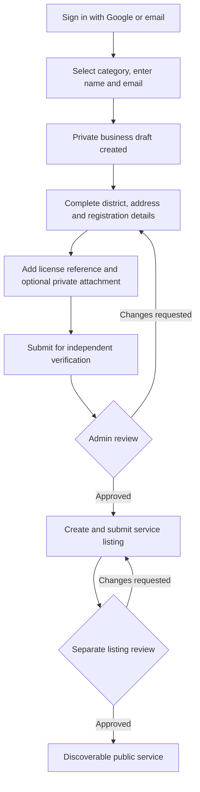
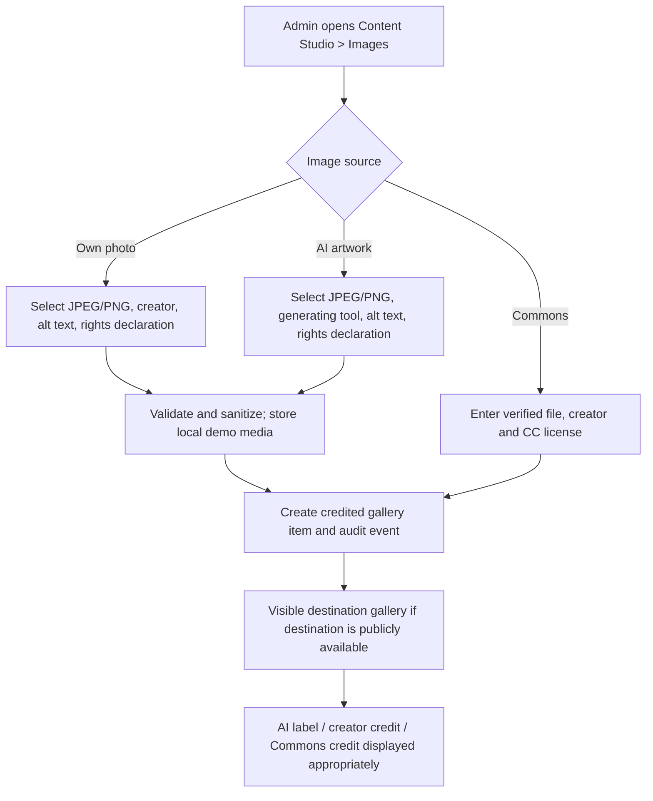

# TOURISMO — Phase 4.4: UX Simplification, Content Media & Product Audit

**Base:** Phase 4.3 (`0012_listing_discovery_indexes`) and fictional demo catalog. **Migration:** `0013_onboarding_media_ux`. **Stage:** local-development increment; not production media infrastructure.

## Executive decision

**Before building map-heavy Phase 5, fix the first experience for both sides of the marketplace.** The original Tourismo blueprint calls for guest-first discovery and low-friction vendor participation. The implementation through Phase 4.3 is technically functional but has avoidable form friction, excessive disclosure of advanced controls, admin-only manual attribution work, and a wide catalog whose content is not uniformly reviewed. Preserving trust requirements does not require showing all requirements at the first click.

### Principles

1. **Quick start, complete later:** create a private vendor draft with business category, name and email; no false data or license verification shortcuts.
2. **One clear next action:** progress panels and separate Business details / Verification / Team tabs. Keep advanced identity documentation just-in-time.
3. **Easy media submission, honest provenance:** owned photos and AI-generated artwork may be uploaded in the local demo. Existing Wikimedia Commons workflow remains available. Every AI image is clearly disclosed as an illustrative image, not factual evidence.
4. **Role-based trust stays server-side:** a self-registered vendor cannot approve their own business or listing. A signed-in user cannot gain platform privileges via their profile.
5. **Separate draft from published:** review requirements remain for content, vendors and listings. Existing data is retained and no fictional business is silently published.
6. **Mobile-first, progressive forms and accessible alternatives:** labels and help text must remain legible, inputs should minimize manual entry, and all meaningful images need appropriate alt text.

## A. Changes implemented in this increment

| Area | Old experience | New experience |
|---|---|---|
| Vendor registration | Long form with category, name, email, phone, registration, license, province, district, address before saving | **Private draft with only category, business name, and email**; email prefilled from account when available; everything else completed later |
| Vendor dashboard | Business application, evidence, scan, submission and team controls all on one long panel | **Three tabs:** business details, verification, optional team; progress and next-step cues |
| Location entry | Free-form district and province, prone to inconsistent spelling | District select covering Sri Lanka's 25 administrative districts; province selected automatically |
| Vendor submission security | License/reference checks | Still requires **province, district, address, registration/license number, and unexpired evidence** before submission; admin verification unchanged |
| Destination slug | Manually type a technical slug | Auto-suggest a URL slug from the title with manual override |
| Destination imagery | Manual Wikimedia Commons file, creator, license | **Upload an owned JPEG/PNG or AI-generated illustrative image** via simple media form, or use the existing Commons option |
| Image source security | Commons attribution only | Explicit media kind (`commons_photo`, `owned_photo`, `ai_illustration`); authorization declaration, alt text, creator/tool and audit event |
| Public labels | “Photo by” for everything | AI images explicitly marked as illustrations; owned photographs credited to uploader; Commons retains photographer + license attribution |
| Local media safety | Remote URLs only | Local pilot images checked for file signature via Pillow, capped at 3 MB input/12 MP, converted to optimized JPEG with EXIF stripped; stored in PostgreSQL; accessible only for visible destinations |
| Production media | Not configured | New local-image upload endpoint **fails closed** outside development until approved object-storage pipeline is implemented |

**Not included:** In-app AI image generation, automatic verification of rights claims, automatic Commons credit lookup, production cloud image storage, automatic email invitations, and the remaining Phase 5 mapping features.

### Quick-start vendor journey



**Trust boundary:** Creating a vendor *draft* is not identity verification, business approval, a public listing, or a paid subscription. Business category and email may be updated within existing authorized states and roles.

### Destination media journey



**Warning:** AI-generated imagery must never be used as proof of a physical property's appearance, an exact monument condition, a verified room, a road, or an operational service. Use accurate photographs and independent records for factual claims. Do not imply intellectual-property ownership automatically follows from an AI prompt; rights depend on jurisdiction and provider terms.

## B. Deeper product-wide friction audit (beginning through Phase 4.3)

These are prioritized proposals, **not claims of implementation** in this increment.

| Priority | Journey | Observed or likely friction | Recommended fix | Validation / acceptance |
|---|---|---|---|---|
| **P0** | Vendor first use | Too many fields before the first save | Implemented: three-field draft, progress, later verification | Median time to first draft target under 2 min in real testing |
| **P0** | Content/media | File/author/license fields felt like a legal form | Implemented: simple owned / AI upload with Commons as alternative | First owned image upload target under 2 min |
| **P0** | Verified status | Fictional demo accounts and vendors could be mistaken for real | Keep demo environment labels, never auto-approve, isolate public catalog | No demo service in verified public search |
| **P0** | Accommodation | Listing schemas contain price/occupancy details but vendor forms may be verbose | Design category-specific wizard with examples, conditional fields, and local draft autosave | Vendors can preview a draft without publishing |
| **P0** | Platform trust | AI image risks visual misrepresentation | Implemented: explicit `ai_illustration` label; require upload declaration | Public screenshot always shows illustration disclosure |
| **P0** | Real imagery | Image rights cannot be inferred from a web search or an AI label | Signed provenance/consent, copyright reports and removal workflow | No image published without attributable provenance |
| **P0** | Admin dashboard | Review of business, content, documents and listings is spread across separate screens | Unified actionable inbox with SLA, severity, assignment and decision history | Reviewer can reach pending case in 2 clicks |
| **P1** | Vendor team | Invitations require an exact internal UUID | Secure email invitation with one-time expiring invite tokens, consent and allowlist/rate limits | Invite works without exposing user directory |
| **P1** | Vendor documents | Must add a license reference and then attach a separate file | Contextual “Add license” mini-wizard combining reference and attachment | Upload cannot bypass malware scan or verification |
| **P1** | Vendor verification | No clear estimate of progress or why evidence needed | Checklist, policy-specific examples, actionable correction email | Reduced abandonments; fewer incomplete submissions |
| **P1** | Listing details | Vendor manually enters too many category fields at once | Templates per category; advanced options hidden until needed | Complete core draft on mobile without horizontal scrolling |
| **P1** | Photo gallery | Existing content photos have separate rights/source demands | One media library, searchable reusable assets, Commons metadata lookup with human review | Credits and license preserved through reuse |
| **P1** | Destination authoring | Slug/lat/lon/source required at same time | Slug auto-suggestion implemented; next add guided content template and POI map picker, sources only when publishing | Draft can be saved without geocoding claims |
| **P1** | Tourist planner | Budget is manually entered and providers are not linked | Add-to-trip from listing with explicit estimated price and confirmation status | No “booked” state without vendor confirmation |
| **P1** | Tourist planning | Guest trips and cloud saves may be hard to resume on another device | Clear saved/draft indicators, just-in-time auth, restore-after-sign-in confirmation | Guest edits survive sign-in and refresh |
| **P1** | Mobile/travel | Many data-entry interactions on mobile | Camera gallery upload, large touch targets, keyboard friendly forms and low-bandwidth mode | Usable on 360px width and slower network |
| **P1** | Localization | Sinhala/Tamil framework but much real content untranslated | Human-reviewed translation queue, transliteration, locale fallback badge | No machine translation presented as reviewed |
| **P1** | Search | Directory sparse before real vendors onboard | Empty states that explain approval rules, show nearby public POIs and optional expansion | No fictional listing presented as verified |
| **P2** | Vendor acquisition | Vendors question effort and return on investment | Before login, public “How it works”, preview sample listing, transparent fees (not invented), no payment until entitlement step | Better first-draft and verification conversion |
| **P2** | Messaging | Contact only via public channels, no tracked inquiries | Consentful quote-request inbox with anti-spam and response SLA | No booking or collection of visitor payment |
| **P2** | Destination photos | No managed hosting/derivatives | Private signed cloud image uploads, scanning/moderation, CDN variants, rights takedown | Production backup, moderation, abuse controls |
| **P2** | Notification volume | Users could receive excessive operational emails | Notification preferences + only high-value events and reminders | Opt-out/transactional behavior clear |
| **P2** | Admin and owner permissions | Too many superuser tasks | Principle of least privilege, role-scoped queues, step-up MFA, break-glass controls | Audit all security-sensitive actions |

## C. Current schema and API changes

- `vendor_organizations.province`, `district`, `operating_address`: now nullable while a draft; *required by explicit server checks before `submitted` state.* Existing records retain values.
- `destination_photos.media_kind`: defaults to `commons_photo` for existing images; allowed values are `commons_photo`, `owned_photo`, `ai_illustration`.
- `destination_image_blobs`: new restricted-content local media table keyed to the photo; images stored as sanitized JPEG bytes plus SHA-256.
- `POST /api/v1/admin/destinations/{slug}/photos/upload`: authenticated platform admin only; multipart JPEG/PNG, provenance, alt text, declaration; **development only**.
- `GET /api/v1/destination-media/{photo_id}`: returns image bytes only when the associated destination is public (`published` or `sample`), otherwise 404.
- Existing Commons endpoint and public attribution responses retained.

**Storage caveat:** DB bytea for 3 MB uploads is appropriate for a *limited local pilot* but inefficient at scale. Do not load the catalog with thousands of media blobs; use immutable object IDs and externally managed storage for production.

## D. Installation (source-only, no Compose change)

From the root of your existing Tourismo project:

```powershell
$patch = "$env:USERPROFILE\Downloads\Tourismo_Phase4_Part4_UX_Simplification_Changes_Only.patch"
git apply --check $patch
git apply $patch
docker compose --env-file .env -f infra/compose.yaml up --build -d
docker compose --env-file .env -f infra/compose.yaml exec app alembic current
```

Expected after rebuilding: `0013_onboarding_media_ux (head)`. The migration follows `0012_listing_discovery_indexes`, so it also requires the Phase 4.3 files to be present in your source.

**Keep your `.env`, local database and ClamAV volumes. Do not run `docker compose down -v`.** The patch does not edit `infra/compose.yaml`.

## E. Local acceptance tests

1. Sign in as tourist and open `/vendors`; start a business with only name, category and business email.
2. Verify the new business is in `draft`; its province/district/address remain `NULL`, not fabricated location data.
3. Open the details tab, choose district, observe province prefill; save address and registration or license number.
4. Try to submit without evidence: server rejects. Add verifiable references, then submit; no auto-approval.
5. Open `/admin` with a *separately granted platform admin*; select a destination, then Photo & attribution.
6. Upload a rights-authorized JPEG/PNG under “My own photograph”; verify gallery and creator label.
7. Upload an AI-generated illustration and explicitly provide the model/tool. The public page **must label it as illustrative AI**.
8. Test invalid file formats and over-3-MB uploads; they should fail. Draft/private destinations cannot expose bytes through the public image route.
9. Verify legacy Commons gallery images still show author, file page, and correct license.
10. Verify the existing test business, user profiles, trips, admin rules, service listings, and demo catalog are unaffected.

Read-only checks:

```sql
SELECT version_num FROM public.alembic_version;
SELECT business_name, verification_state, district, province FROM public.vendor_organizations ORDER BY created_at DESC LIMIT 15;
SELECT media_kind, count(*) FROM public.destination_photos GROUP BY media_kind;
SELECT count(*) AS locally_uploaded_images FROM public.destination_image_blobs;
```

**Testing status in this release:** backend unit/security suite and TypeScript syntax/transpilation checks run in the builder. Full Vite dependency installation, Docker/PostGIS migrations and Clerk-browser acceptance are to be verified on the user's machine.

## F. Prioritized roadmap after UX cleanup

- **Next UX increment:** vendor listing wizard by service category, private business/public listing preview, and email invitation infrastructure with expiring scoped tokens. This is more useful before adding more fields or broadening location search.
- **Content editor increment:** searchable central media library, batch uploads, automatic Commons metadata suggestions subject to human verification, attribution preview, rights-claim dispute/takedown flow.
- **Phase 5:** interactive 2D map and linked destination/listing cards with licensed tiles, location privacy, zoom/filter synchronization and supported directions handoff.
- **Phase 6:** provider-to-trip matching, richer budget and itinerary UX, carefully differentiated estimated/quoted/confirmed states.
- **Later:** transport/weather source integrations, trust/reviews, subscriptions, payment gateway, grounded assistant, public beta, and production storage/operations. **Tourist booking and payment remain outside the current release.**

## G. Research and design references

- Original `docs/MASTER_BLUEPRINT_v1.1.md` (guest-first requirements and vendor ownership).
- [NN/g on minimizing cognitive load with progressive disclosure](https://www.nngroup.com/articles/4-principles-reduce-cognitive-load/).
- [W3C WCAG 2.2 text alternatives](https://www.w3.org/TR/wcag/).
- [Creative Commons attribution: title/author/source/license](https://creativecommons.org/reusing-cc-licensed-content/).
- [Cloudinary signed versus unsigned uploads](https://cloudinary.com/documentation/upload_images) (signed, server-authorized uploads recommended for any later production media service).
- [U.S. Copyright Office: copyrightability of AI-generated outputs](https://copyright.gov/newsnet/2025/1060.html) (jurisdiction-specific; not legal advice).
