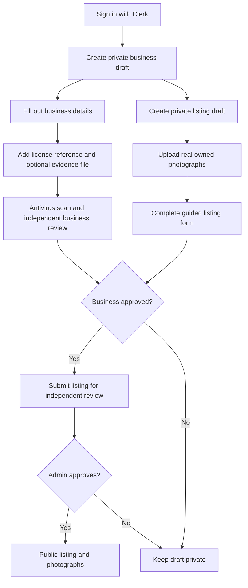

# Tourismo — Phase 4.5 Part 2: Vendor Experience Simplification

**Incremental release · 20 November 2026 · Requires Phase 4.5 Part 1 / Alembic 0013**

## Purpose

Reduce friction for small tourism businesses without allowing unverified claims, unsafe documents, or unreviewed services into the public directory. This release covers three high-friction workflows discovered in the Phase 4.4 product audit.

| Before | After | Boundary |
|---|---|---|
| Listing photos required manually typed image URL, source URL, credit, license URL | Owner/manager can upload a real JPEG/PNG from the listing's private draft | **Development only**, max 3 MB, decoded and re-encoded; no production upload until object storage and moderation are configured |
| License reference saved in one form, then file uploaded in another | One guided form saves the reference and optionally attaches a private PDF/JPEG/PNG | Existing ClamAV scan and admin verification remain required |
| Team invitations required a raw PostgreSQL UUID | Business owner enters an existing Tourismo member's verified email | **In-app only**, no outgoing email, no automatic invitation acceptance or role grant |

### Overall user journey



## What changed

### A. Photos: upload instead of manually entering URLs

- The vendor listing editor now displays **Upload a real service photo (local development)** for editable listing drafts and previously returned drafts.
- The vendor selects a local JPEG/PNG, enters photographer/owner and accessible description, and confirms usage rights and accuracy.
- `Pillow` decodes, bounds and re-encodes the file as JPEG, strips EXIF/location metadata, and stores a SHA-256 digest with the sanitized bytes in Postgres.
- The new table `service_listing_image_blobs` stores sanitized bytes against `service_listing_photos`. The image is not exposed in the public media route until the associated listing is independently published and the business remains verified.
- The owner/manager can preview unpublished uploads through an authenticated private endpoint. A guest cannot access the draft media endpoint or see the photo through its public URL.
- The upload endpoint rejects AI-generated art used as alleged photographic evidence of a real provider. For destination guides, Phase 4.4's separately labeled AI illustrations remain supported.
- Existing externally hosted, credited HTTPS images remain supported. Published-listing revisions preserve previously uploaded media records and their images.

**New routes:**

- `POST /api/v1/vendor/organizations/{org_id}/listings/{listing_id}/photos/upload` — authenticated owner/manager, draft only, multipart form.
- `GET /api/v1/vendor/organizations/{org_id}/listings/{listing_id}/photos/{photo_id}/preview` — authenticated vendor team, private media preview.
- `GET /api/v1/listing-media/{photo_id}` — public only when listing and organization satisfy existing public approval and current-evidence rules.

**Important limitations:** This release stores only *development* media in the local PostgreSQL database; it is not designed for high-volume production images. Production upload is blocked until managed object storage, content-moderation workflow, cloud backups and appropriate resizing/AV policies are implemented. The public media endpoint is still gated by publication; owned draft images are intentionally not publicly linkable.

### B. One guided license + document step

- Under **Business dashboard → Verification**, the add-reference form includes an optional file input.
- With a file selected, the app first creates the evidence-reference record through the existing private API, then uploads the file linked to that new reference.
- If the upload fails, **the saved license reference remains** and can be selected below to retry the document upload. No false success is displayed for a failed second step.
- PDFs, PNGs and JPEGs remain capped at 5 MB and subject to the existing malware scanner and secure private file handling; pending or infected files cannot be downloaded as approved evidence.
- Verified licenses still require human/independent review. The UX change does not relax submission or approval requirements.

### C. Email-address team invitations

- Business owners enter the invitee's email address and choose **staff** or **manager**.
- The server only resolves existing *active*, Clerk-backed local Tourismo accounts whose email was obtained during verified Clerk profile bootstrap (the browser cannot supply another user's identity claims).
- The existing `vendor_memberships` table and pending/accepted workflow are reused; the invitee must sign in and accept under the Vendor dashboard.
- **No invitation email is sent.** The business owner must tell the colleague to sign in and check their invitation. Unregistered external recipients cannot yet be invited. If an account's verified email has not synchronized, the invitation will not resolve.
- To populate verified email, configure `CLERK_SECRET_KEY` in the server-only `.env` (not any `VITE_` property) and ask each user to sign in again so Clerk profile synchronization runs.
- Only organization owners can invite; managers/staff cannot grant themselves extra roles. Users cannot invite themselves.

**New route:** `POST /api/v1/vendor/organizations/{org_id}/members/by-email`.

## Database changes

- Adds migration `0014_vendor_experience` (down revision `0013_onboarding_media_ux`).
- Adds `service_listing_image_blobs` with FK to existing `service_listing_photos` and no alterations to user, vendor, trip, destination, or existing listing records.
- All prior user profiles, draft/demo businesses, document metadata, listing revisions and content remain intact.

## Apply the changes-only patch

From the existing project directory (example `D:\Tourismo\Tourismo`):

```powershell
$patch = "$env:USERPROFILE\Downloads\Tourismo_Phase4_Part5_Part2_Vendor_Ease_Changes_Only.patch"
git apply --check $patch
git apply $patch

docker compose --env-file .env -f infra/compose.yaml up --build -d
docker compose --env-file .env -f infra/compose.yaml ps
```

Run the check **before**, not after, applying a patch. If the check fails, don't force it; reconcile local changes. Do **not** run `docker compose down -v`.

To confirm the migration without PowerShell/Alembic stderr interference:

```powershell
docker compose --env-file .env -f infra/compose.yaml exec -T db psql -U tourismo -d tourismo -At -c "SELECT version_num FROM alembic_version;"
```

Expected: `0014_vendor_experience`. Read-only script: `powershell -ExecutionPolicy Bypass -File .\scripts\verify-phase452.ps1`.

### DBeaver verification

```sql
SELECT version_num FROM public.alembic_version;
SELECT COUNT(*) AS local_service_photos FROM public.service_listing_image_blobs;
SELECT COUNT(*) AS provider_photos FROM public.service_listing_photos;
SELECT COUNT(*) AS pending_invitations FROM public.vendor_memberships WHERE state = 'pending';
SELECT scan_state, count(*) FROM public.vendor_documents WHERE deleted_at IS NULL GROUP BY scan_state;
```

No uploaded photos are expected until an authenticated vendor uploads them. The public listing directory remains empty of fictional draft listings.

## Manual acceptance checks

1. `0014_vendor_experience` is at the Alembic head and both app/database are up.
2. Sign in as a business owner; start a private listing draft. Upload a rights-confirmed real JPEG photo. Verify the photo appears in the private vendor gallery and the public photo URL responds 404 before publication.
3. Try an invalid file or >3 MB file; it must fail, not create a photo row.
4. Add a license reference and PDF in a single guided action; confirm a `vendor_evidence` row and a `vendor_documents` row. If scan service is off, its state stays `pending_scan`.
5. Invite a second Clerk account using its **verified email**. It must appear as a *pending* in-app invitation, not an active membership. Have the second user accept it.
6. Confirm that another vendor cannot preview a different organization's private uploaded photograph.
7. Approve a real test business/listing with a separate administrator. Photo becomes visible only after successful independent publication and current business verification.
8. Verify that editing and approving a published listing revision retains any local uploaded-photo bytes and URLs. Do not use fictional demo businesses for public approval.

## Test execution and honest limitations

Backend regression suite ran in the build environment: **110 passed, 5 skipped** (PostgreSQL integration tests require a disposable live database). Changed TypeScript/TSX files passed syntax/transpilation checks, not a complete Vite production build. Live Docker migration, browser interaction and Clerk integration still require verification on your local machine. No automated email delivery, in-dashboard AI image generation, production media storage, tourist bookings or payments are added by this increment.

## Next priorities

- Add **tokenized external email invitation delivery** with expiry, abuse limits, confirmed email ownership and revocation; do not invent invitations for unregistered users.
- Replace PostgreSQL BLOB developer storage with a moderated, licensed media library and managed storage.
- Further reduce friction with step autosave and smartphone usability testing.
- Proceed to Phase 5: map-based listing discovery and attraction pins, with compliant tile usage and sourced coordinates.
